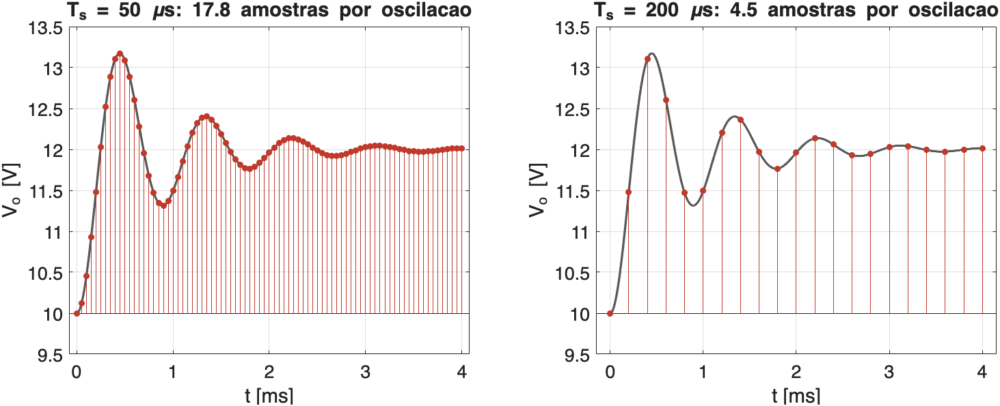
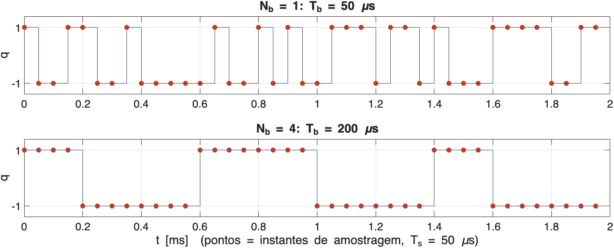
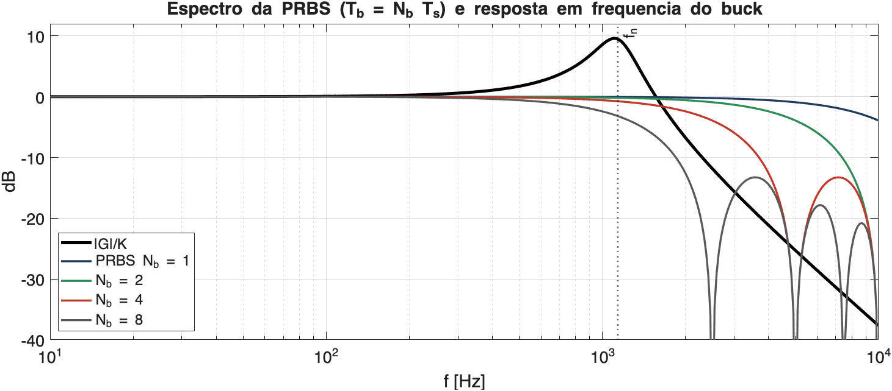
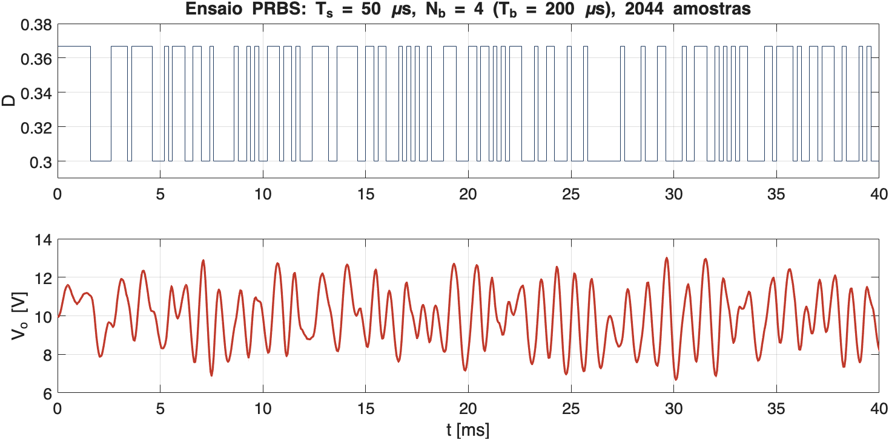
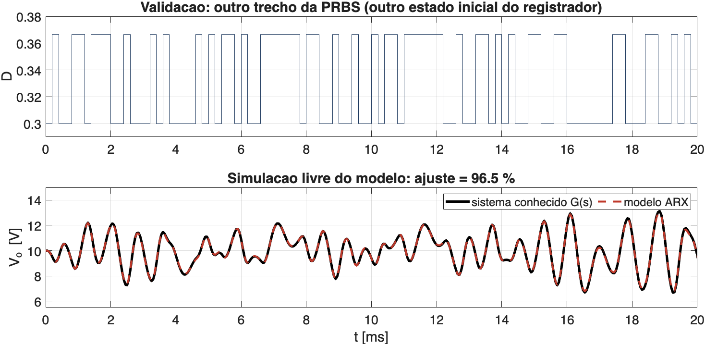
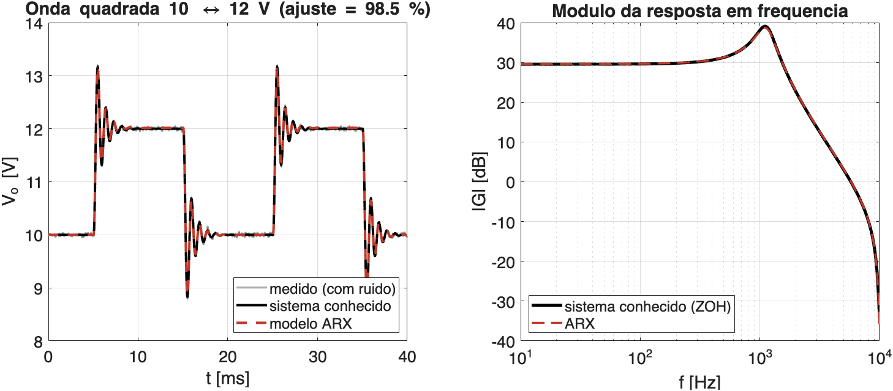

## O conversor e o modelo nominal

:::: {.columns}
::: {.column width="50%"}
Grandezas totais (maiúsculas) = ponto de operação + variação (minúsculas):

$$
D = D_0 + d, \qquad V_o = V_{o0} + y
$$

com $D_0 = 1/3$ e $V_{o0}$ = 10 V ($V_{in}$ = 30 V). O modelo médio relaciona as
variações:

$$
G(s) = \frac{Y(s)}{D(s)} = \frac{1{,}532\cdot 10^{9}}{s^2 + 2400\,s + 5{,}106\cdot 10^{7}}
$$
:::
::: {.column width="50%"}
| Grandeza | Valor |
|---|---|
| Ganho estático $K$ | 30 V ($= V_{in}$) |
| Frequência natural $f_n$ | 1137 Hz |
| Amortecimento $\xi$ | 0,168 |
| Período da oscilação $T_d$ | 0,89 ms |
| Sobressinal ao degrau | 58 % |
| Acomodação (2 %) | 3,2 ms |
:::
::::

Tudo a seguir é simulado em MATLAB (`analise/ident_buck.m`), com este $G(s)$ no papel da planta.

## Período de amostragem: o que se quer ver

{fig-align="center" width="95%"}

Degrau de $D$ = 1/3 → 0,4. Com $T_s$ = 200 µs, cada oscilação tem só 4 ou 5 pontos: os dados
quase não mostram a forma do transitório, e o modelo discreto fica mal determinado.

## Critérios para $T_s$

1. **Amostras por oscilação**: $\omega_n T_s \approx 0{,}2$ a $0{,}6$ (Åström & Wittenmark),
   ou seja, 10 a 30 amostras por período $T_d$;
2. **Não amostrar rápido demais**: com $T_s$ pequeno, os polos discretos $z = e^{sT_s}$ ficam
   colados em 1, e $y(k)$, $y(k-1)$, $y(k-2)$ quase não diferem: mínimos quadrados mal
   condicionados;
3. **Limite da placa**: no máximo uma amostra por período do PWM (20 kHz → 50 µs).

| [$T_s$]{style="text-transform:none"} | [10 µs]{style="text-transform:none"} | [25 µs]{style="text-transform:none"} | [50 µs]{style="text-transform:none"} | [100 µs]{style="text-transform:none"} | [200 µs]{style="text-transform:none"} |
|---|---|---|---|---|---|
| $\omega_n T_s$ | 0,07 | 0,18 | **0,36** | 0,71 | 1,43 |
| Amostras por oscilação | 89 | 36 | **18** | 9 | 4,5 |
| $\lvert z \rvert$ dos polos | 0,988 | 0,970 | **0,942** | 0,887 | 0,787 |

## Escolha: $T_s$ = 50 µs

- $\omega_n T_s$ = 0,36, no meio da faixa; 18 amostras por oscilação;
- Uma amostra por período do PWM, no meio do intervalo de condução (longe das comutações).

Modelo discreto esperado (ZOH), com o **atraso de uma amostra do firmware**: o novo CMPA só
vale no período seguinte, então $d(k)$ só aparece em $y(k+2)$:

$$
y(k) = 1{,}768\,y(k-1) - 0{,}887\,y(k-2) + 1{,}821\,d(k-2) + 1{,}750\,d(k-3)
$$

Estrutura a identificar: **ARX(2,2,2)** — 2 polos, 2 coeficientes de entrada, atraso de 2 amostras.

## PRBS: o sinal

Sequência binária pseudoaleatória $q(k) = \pm 1$, gerada por um registrador de deslocamento de
$n$ = 9 bits ($x^9 + x^5 + 1$):

- Repete-se a cada $2^n - 1$ = 511 bits; média quase nula (256 bits +1, 255 bits −1);
- O trecho mais longo sem troca tem $n$ = 9 bits;
- Espectro aproximadamente plano: excita todas as frequências até um limite.

Aplicada como variação em torno do ponto de operação:

$$
d(k) = A\,q(k), \quad A = 1/30 \qquad\Rightarrow\qquad D \in \{0{,}300;\ 0{,}367\}
$$

Em regime, $V_o$ ficaria entre 9 e 11 V; a ressonância amplia essa faixa nos transitórios.

## $N_b$ e $T_b$: quanto dura cada bit

{fig-align="center" width="95%"}

Os mesmos bits nos dois casos: com $N_b$ = 4, cada bit fica 4 amostras no mesmo nível.
A duração do bit é $T_b = N_b\,T_s$; $T_s$ continua 50 µs.

## As grandezas da PRBS

| Grandeza | Expressão | [$n$ = 9, $N_b$ = 4, $T_s$ = 50 µs]{style="text-transform:none"} |
|---|---|---|
| Duração do bit | $T_b = N_b T_s$ | 200 µs |
| Pulso mais longo | $n\,T_b$ | 1,8 ms |
| Faixa excitada (−3 dB) | $\approx 0{,}44/T_b$ | 2,2 kHz |
| Primeiro nulo do espectro | $1/T_b$ | 5 kHz |
| Período da sequência | $(2^n - 1)\,T_b$ | 102,2 ms |
| Amostras por período | $(2^n - 1)\,N_b$ | 2044 |

$T_s$ fixa a resolução no tempo; $N_b$ escolhe $T_b$ sem mudar $T_s$.

## Como escolher $T_b$

Dois requisitos que puxam em sentidos opostos:

1. **Excitar a ressonância**: a faixa $0{,}44/T_b$ deve ir além de $f_n$, com folga
   ($\approx 2 f_n$ = 2,3 kHz):
   $$T_b \lesssim \frac{0{,}44}{2 f_n} \approx 190\ \text{µs}$$
2. **Excitar o ganho estático**: o pulso mais longo deve durar uma fração boa da
   acomodação ($\approx t_s/2$ = 1,6 ms):
   $$n\,T_b \gtrsim 1{,}6\ \text{ms} \;\Rightarrow\; T_b \gtrsim 180\ \text{µs}$$

Os dois se encontram em $T_b \approx$ 200 µs, ou seja, **$N_b$ = 4** com $T_s$ = 50 µs.

## Espectro da PRBS × buck

{fig-align="center" width="95%"}

$N_b$ = 1 espalha a energia até 9 kHz, onde o buck já atenua: sobra pouco sinal na saída.
$N_b$ = 8 tem um nulo em 2,5 kHz, muito perto da ressonância.

## Conferindo pela simulação: varredura de $N_b$

100 ensaios simulados por $N_b$, ruído de medida $\sigma$ = 20 mV; ajuste na validação (sem ruído):

| [$N_b$]{style="text-transform:none"} | [$T_b$ [µs]]{style="text-transform:none"} | Pulso mais longo [[ms]]{style="text-transform:none"} | Ajuste [%] | Erro em [$K$]{style="text-transform:none"} [%] | Erro em [$\omega_n$]{style="text-transform:none"} [%] | Erro em [$\xi$]{style="text-transform:none"} [%] |
|---|---|---|---|---|---|---|
| 1 | 50 | 0,45 | 96,9 | 0,8 | 0,7 | 16 |
| 2 | 100 | 0,90 | 98,2 | 0,6 | 0,4 | 9,1 |
| **4** | **200** | **1,80** | **98,5** | **0,8** | **0,3** | **5,9** |
| 8 | 400 | 3,60 | 98,3 | 1,0 | 0,5 | 5,9 |
| 16 | 800 | 7,20 | 95,8 | 1,1 | 2,4 | 21 |

$N_b$ = 4 tem o melhor ajuste e o menor erro no amortecimento, como previsto pelos dois requisitos.

## Código: PRBS

```matlab
% PRBS de +-1 com registrador de 9 bits (x^9 + x^5 + 1, periodo 511 bits);
% um bit novo a cada Nb amostras
function q = PRBS(N, Nb)
    reg = ones(1, 9);
    q   = zeros(N, 1);
    for k = 1:N
        if mod(k-1, Nb) == 0                      % so a cada Nb amostras
            reg = [xor(reg(9), reg(5)), reg(1:8)];
        end
        q(k) = 2*reg(9) - 1;
    end
end
```

```matlab
Ts = 50e-6;  Gz = c2d(Gs, Ts, 'zoh');
Gzp = Gz * tf(1, [1 0], Ts);                      % atraso do firmware
d = (1/30)*PRBS(2044, 4);                         % Nb = 4: um periodo
y = lsim(Gzp, d) + 0.02*randn(2044, 1);           % ruido de medida de 20 mV
```

## Na placa: `PWM_prbs`

```c
#define PRBS_NB  4U                     // amostras por bit: Tb = 4 x 50 us = 200 us

static inline float Gerar_Proximo_PRBS_Simulink(void) {
    if (prbs_cont == 0) {               // so a cada PRBS_NB amostras
        uint16_t bit9 = (lfsr >> 8) & 0x0001;
        uint16_t bit5 = (lfsr >> 4) & 0x0001;
        uint16_t feedback = bit9 ^ bit5;
        lfsr = ((lfsr << 1) | feedback) & 0x01FF;          // 9 bits
        prbs_duty = (feedback != 0) ? PRBS_DUTY_HIGH : PRBS_DUTY_LOW;
    }
    prbs_cont++;
    if (prbs_cont >= PRBS_NB) prbs_cont = 0;
    return prbs_duty;
}
```

- Chamada a cada $T_s$ = 50 µs (disparo do ADC no zero do ePWM1);
- `TAM_EXP` = 2044 amostras: um período completo da sequência.

## Ensaio simulado

{fig-align="center" width="95%"}

A ressonância amplifica a resposta aos bits curtos: $V_o$ oscila entre 7 e 13 V, ainda
longe dos 30 V da entrada.

## ARX por mínimos quadrados

Com $d$ e $y$ = variações em torno do ponto de operação (na prática, tira-se a média dos dados):

$$
y(k) = -a_1\,y(k-1) - a_2\,y(k-2) + b_1\,d(k-2) + b_2\,d(k-3)
$$

```matlab
function [b, a] = ARX(d, y)
    d = d - mean(d);  y = y - mean(y);
    k = (4:numel(y))';
    Phi   = [-y(k-1), -y(k-2), d(k-2), d(k-3)];
    theta = Phi \ y(k);                           % minimos quadrados
    a = [1, theta(1:2)'];
    b = theta(3:4)';
end
```

## Modelo identificado ($N_b$ = 4)

| Coeficiente | Nominal (ZOH) | ARX |
|---|---|---|
| $a_1$ | −1,768 | −1,761 |
| $a_2$ | 0,887 | 0,880 |
| $b_1$ | 1,821 | 1,828 |
| $b_2$ | 1,750 | 1,778 |

Todos os coeficientes a menos de 2 % dos valores do modelo nominal discretizado.

## Modelo contínuo equivalente

Conversão do ARX para tempo contínuo (`d2c`, sem o atraso do firmware):

$$
G_{id}(s) = \frac{1{,}553\cdot 10^{9}}{s^2 + 2552\,s + 5{,}136\cdot 10^{7}}
$$

| | Nominal | Identificado | Erro |
|---|---|---|---|
| $K$ | 30,0 V | 30,2 V | 0,8 % |
| $\omega_n$ | 7146 rad/s | 7167 rad/s | 0,3 % |
| $\xi$ | 0,168 | 0,178 | 6 % |

O amortecimento é o parâmetro mais sensível ao ruído de medida.

## Validação: outro trecho da PRBS

{fig-align="center" width="95%"}

Mesma PRBS com outro estado inicial do registrador (dados não usados na identificação):
simulação livre do modelo ARX contra o sistema conhecido $G(s)$, ajuste de 96,5 %.

## Validação: onda quadrada 10 ↔ 12 V

{fig-align="center" width="95%"}

Entrada do `BK01Degrau` ($D$ = 1/3 ↔ 0,4): ajuste de 98,5 %; o módulo da resposta em
frequência coincide com o do sistema conhecido, inclusive na ressonância.

## Ruído de medida

| [$\sigma$]{style="text-transform:none"} | [5 mV]{style="text-transform:none"} | [10 mV]{style="text-transform:none"} | [20 mV]{style="text-transform:none"} | [50 mV]{style="text-transform:none"} |
|---|---|---|---|---|
| Ajuste na validação | 99,9 % | 99,6 % | **98,5 %** | 91,9 % |
| Erro em $K$ | 0,05 % | 0,2 % | **0,8 %** | 4,7 % |
| Erro em $\xi$ | 0,4 % | 1,5 % | **5,9 %** | 36 % |

- Estimativa para a placa: resolução do ADC com o divisor ≈ 7 mV, mais a ondulação
  residual e a interferência do chaveamento → **20 mV**;
- O ARX supõe o ruído na equação, não na medida: com ruído de medida, os mínimos quadrados
  são polarizados, e o erro cresce rápido com $\sigma$ (com 50 mV, $\xi$ sai 36 % maior).

## Conclusões

- **$T_s$ = 50 µs** ($= 1/f_{PWM}$): 18 amostras por oscilação, $\omega_n T_s$ = 0,36;
- **$N_b$ = 4** ($T_b$ = 200 µs): faixa excitada ≈ 2 $f_n$ e pulso mais longo ≈ $t_s/2$;
  confirmado pela varredura;
- **2044 amostras** = um período da PRBS de 9 bits ($511 \times 4$);
- Estrutura **ARX(2,2,2)**: o atraso do PWM acrescenta uma amostra ao modelo ZOH;
- Medir o ruído real na placa (trecho em $D_0$ constante): acima de ≈ 30 mV, vale filtrar,
  usar a média de vários períodos ou um modelo de erro de saída (OE).
