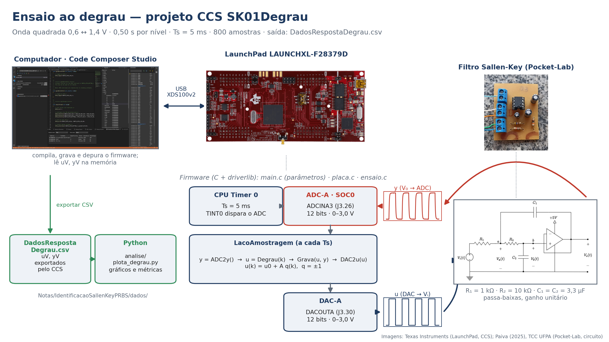
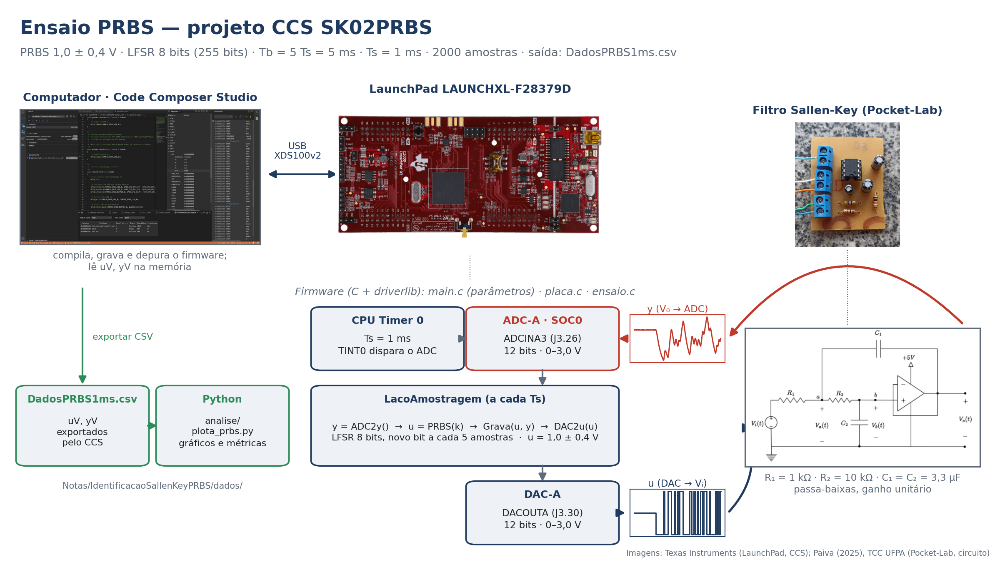
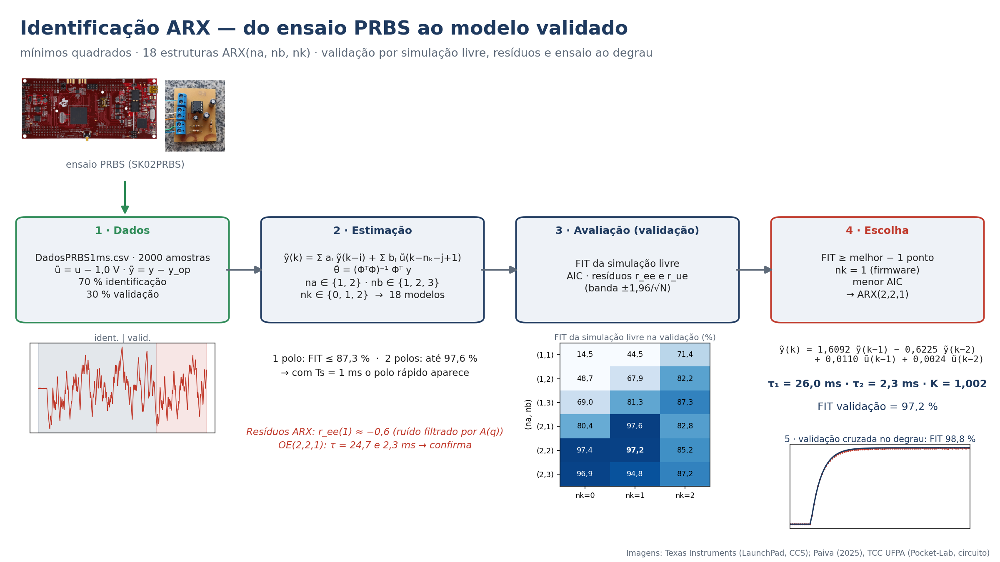

```{python}
#| label: setup
import sys
import numpy as np
import matplotlib.pyplot as plt
from scipy.optimize import curve_fit
from IPython.display import Markdown

sys.path.insert(0, "analise")
import plota_degrau as pd_   # leitura do CSV do CCS, parâmetros do firmware e modelo analítico

plt.style.use("../../estilo_graficos.mplstyle")
AZUL, VERMELHO, CINZA, VERDE = "#1F3A5F", "#C0392B", "0.35", "#2E8B57"

br = lambda x, n=2: f"{x:.{n}f}".replace(".", ",")
ms = lambda x: br(1e3 * x, 1)
r2 = lambda v, m: 1 - np.sum((v - m) ** 2) / np.sum((v - v.mean()) ** 2)

# Modelo analítico (componentes nominais)
R1, R2, C1, C2 = pd_.R1, pd_.R2, pd_.C1, pd_.C2
w0 = 1 / np.sqrt(R1 * R2 * C1 * C2)
a1 = 1 / (R1 * C1) + 1 / (R2 * C2)
xi = a1 / (2 * w0)
polos = np.sort(np.roots([1, a1, w0**2]).real)[::-1]
tau_nom = -1 / polos
```

## Roteiro

1. **Montagem**: LaunchPad, filtro Sallen-Key e modelo analítico;
2. **Firmware**: projetos do Code Composer Studio para os ensaios;
3. **Resposta ao degrau**: ensaio e análise dos resultados;
4. **Resposta à PRBS**: projeto do sinal e ensaio;
5. **Identificação**: modelo ARX por mínimos quadrados e validação.

Recursos gerais da placa (DAC, ADC, amostragem por hardware, exportação de dados):
[Nota 01 — Placa LAUNCHXL-F28379D](../Nota01LaunchPadF28379D.qmd).

# Montagem

## LaunchPad no ensaio

| Recurso | Uso neste ensaio |
|---|---|
| **DAC-A** (DACOUTA, J3.30) | gera a entrada $u$ do filtro |
| **ADC-A** (ADCINA3, J3.26) | mede a saída $y$ do filtro |
| **CPU Timer 0** | período de amostragem $T_s$ (5 ms no degrau, 1 ms na PRBS); dispara o ADC (TINT0) |
| **ADCA INT1** | interrupção de fim de conversão: lei de excitação |
| **RAMGS0 / RAMGS1** | vetores gravados de $u$ e $y$ |

- Excitação entre **0,6 V e 1,4 V** (ponto de operação 1,0 V): longe das saturações do DAC,
  do ADC (0–3,0 V) e do amplificador operacional;
- Resolução do DAC/ADC: $3{,}0/4095 \approx 0{,}73$ mV.

## Filtro Sallen-Key passa-baixas de 2ª ordem

:::: {.columns}
::: {.column width="55%"}
Topologia Sallen-Key de ganho unitário:

$$
H(s) = \frac{\omega_0^2}{s^2 + 2\xi\omega_0 s + \omega_0^2}
     = \frac{1}{(\tau_1 s + 1)(\tau_2 s + 1)}
$$

$$
\omega_0 = \frac{1}{\sqrt{R_1R_2C_1C_2}}, \qquad
2\xi\omega_0 = \frac{1}{R_1C_1} + \frac{1}{R_2C_2}
$$
:::
::: {.column width="45%"}
```{python}
Markdown(f"""
| Grandeza | Valor nominal |
|---|---|
| $R_1$, $R_2$ | 1 kΩ, 10 kΩ |
| $C_1 = C_2$ | 3,3 µF |
| $\\omega_0$ | {br(w0, 1)} rad/s ($f_0$ = {br(w0 / (2 * np.pi), 1)} Hz) |
| $\\xi$ | {br(xi)} — **sobreamortecido** |
| Polos | {br(polos[0], 1)} e {br(polos[1], 1)} rad/s |
| $\\tau_1$, $\\tau_2$ | {ms(tau_nom[0])} ms, {ms(tau_nom[1])} ms |
""")
```
:::
::::

Componentes do *pocket-lab* do TCC *Filtro Sallen-Key como pocket-lab para ensino de
identificação e controle de sistemas dinâmicos*.

## Resposta ao degrau esperada

Para $\xi > 1$ (polos reais), a resposta a um degrau de amplitude $\Delta u$ a partir de
$y_0$ é

$$
y(t) = y_0 + K\,\Delta u\left[1 - \frac{\tau_1 e^{-t/\tau_1} - \tau_2 e^{-t/\tau_2}}{\tau_1 - \tau_2}\right]
$$

- Sem sobressinal e sem oscilação;
- Dinâmica dominada por $\tau_1$ (polo lento): $\approx 63\,\%$ do valor final em $t \approx \tau_1 + \tau_2$;
- Ganho estático $K = H(0) = 1$.

# Firmware: projetos no CCS

## Organização

Pasta `ProjetosSK/` — um projeto CCS por ensaio, ambos com a
estrutura de amostragem por hardware da [Nota 01](../Nota01LaunchPadF28379D.qmd):

| Projeto | Ensaio | Situação |
|---|---|---|
| `SK01Degrau/` | onda quadrada 0,6 ↔ 1,4 V, 4 ciclos; ensaio feito com $T_s$ = 5 ms e 800 amostras (o projeto já está em 1 ms, 2000 amostras) | concluído |
| `SK02PRBS/` | PRBS 1,0 ± 0,4 V, $T_b$ = 5 ms, $T_s$ = 1 ms, 2000 amostras | concluído |

Organização dos dois projetos (o padrão a seguir nos demais):

| Arquivo | Função |
|---|---|
| `main.c` | parâmetros do ensaio em unidades físicas ($T_s$, $u_0$, $A$, tempos) e o laço de amostragem |
| `placa.c/.h` | LaunchPad: `ConfiguraF28379D(Ts, ...)`, `IniciaAmostragem()`, `ADC2y()`, `DAC2u(u)`, `FimAmostragem()` |
| `ensaio.c/.h` | o ensaio: `Degrau(k)` ou `PRBS(k)` e `Grava(u, y)` em `uV`, `yV` |

Dados exportados do CCS em CSV para `dados/` (`DadosRespostaDegrau.csv`, `DadosPRBS1ms.csv`).

## Firmware do ensaio ao degrau (`SK01Degrau`, versão do ensaio)

:::: {.columns}
::: {.column width="52%"}
```{.c}
const ParametrosDegrau p = {
    .Ts       = 5e-3f,  // periodo de amostragem [s]
    .u0       = 1.0f,   // nivel medio de u [V]
    .A        = 0.4f,   // u entre 0,6 e 1,4 V
    .Tq       = 1.0f,   // periodo da onda quadrada [s]
    .tAtraso  = 0.2f,   // antes da subida [s]
    .tAcomoda = 2.0f,   // antes de gravar [s]
};
ConfiguraF28379D(p.Ts, LacoAmostragem);
ConfiguraEnsaioDegrau(&p);
IniciaAmostragem();
```
:::
::: {.column width="48%"}
```{.c}
// a cada Ts (fim da conversao do ADC)
__interrupt void LacoAmostragem(void)
{
    float y = ADC2y();     // y(k)
    float u = Degrau(k);   // u(k) = u0 + A q(k)
    Grava(u, y);           // uV[k], yV[k]
    DAC2u(u);              // u(k) -> DAC
    FimAmostragem();
}
```
:::
::::

- $u(k) = u_0 + A\,q(k)$, $q = \pm 1$: cada meio período (0,5 s) é um degrau completo — o
  filtro acomoda em ≈ 0,13 s;
- $y(k)$ é lido **antes** de $u(k)$ ir para o DAC: o efeito de $u(k)$ aparece em $y(k+1)$
  (**atraso de uma amostra**);
- No `SK02PRBS`, só muda a lei de $u(k)$: o LFSR gera um novo bit a cada 5 amostras ($T_s$ = 1 ms).

# Resposta ao degrau

```{python}
#| label: degrau
# Ensaio SK01Degrau: onda quadrada u = u0 + A q(k), 800 amostras (dados/DadosRespostaDegrau.csv)
d = pd_.le_csv_ccs("dados/DadosRespostaDegrau.csv")
y, u = d["yV"], d["uV"]
N = len(y)
t = np.arange(N) * pd_.TS
y_mod = pd_.resposta_analitica(t, u)

# subidas e descidas detectadas no próprio u
trocas = np.where(np.abs(np.diff(u)) > 1e-6)[0] + 1
sobe = [k for k in trocas if u[k] > u[k - 1]]
desce = [k for k in trocas if u[k] < u[k - 1]]
nm = int(np.min(np.diff(trocas))) if len(trocas) > 1 else N - trocas[0]   # amostras por nível
kd = sobe[0]
uB, uA = u[0], u[kd]
du = uA - uB

# média dos ciclos: cada trecho começa uma amostra antes da troca
def media(v, inicios):
    return np.mean([v[k0 - 1:k0 + nm] for k0 in inicios if k0 + nm <= len(v)], axis=0)
ts_seg = (np.arange(nm + 1) - 1) * pd_.TS          # tempo após a troca
yS, yD_ = media(y, sobe), media(y, desce)          # subida e descida médias (medido)
mS, mD_ = media(y_mod, sobe), media(y_mod, desce)  # idem, modelo analítico
nS, nD = len([k for k in sobe if k + nm <= N]), len([k for k in desce if k + nm <= N])

y0, yf = yS[0], yS[-20:].mean()
K = (yf - y0) / du
ruido = np.mean([y[k0 + nm - 40:k0 + nm].std() for k0 in sobe + desce if k0 + nm <= N])

def instante(v, frac):
    a, b_ = v[0], v[-20:].mean()
    return ts_seg[np.argmax((v - a) / (b_ - a) >= frac)]

def acomodacao(v, faixa=0.02):
    a, b_ = v[0], v[-20:].mean()
    fora = np.where(np.abs(v[1:] - b_) > faixa * abs(b_ - a))[0]
    return ts_seg[fora[-1] + 2] if len(fora) else 0.0

met = {nome: dict(t10=instante(v, .1), t63=instante(v, .632), t90=instante(v, .9), ts=acomodacao(v))
       for nome, v in (("med", yS), ("mod", mS), ("med_desce", yD_))}

# ajuste de 2ª ordem (K, tau1, tau2) à subida média
td, yd = ts_seg[1:], yS[1:]
def degrau2(tt, Kf, t1, t2):
    return y0 + Kf * du * (1 - (t1 * np.exp(-tt / t1) - t2 * np.exp(-tt / t2)) / (t1 - t2))
(K_aj, t1_aj, t2_aj), _ = curve_fit(degrau2, td, yd, p0=[1, 0.033, 0.003])
y_aj = np.r_[y0, degrau2(td, K_aj, t1_aj, t2_aj)]

def degrau_C(tt, C):
    p = np.roots([1, 1 / (R1 * C) + 1 / (R2 * C), 1 / (R1 * R2 * C * C)]).real
    t1, t2 = -1 / p
    return y0 + (yf - y0) * (1 - (t1 * np.exp(-tt / t1) - t2 * np.exp(-tt / t2)) / (t1 - t2))
(C_eq,), _ = curve_fit(degrau_C, td, yd, p0=[3.3e-6])

R2_mod, R2_aj = r2(yS[1:], mS[1:]), r2(yS[1:], y_aj[1:])
```

## Diagrama do ensaio ao degrau

{width=100%}

## Ensaio (`SK01Degrau`)

```{python}
#| fig-width: 15
#| fig-height: 5.6
fig, ax = plt.subplots(figsize=(15, 5.6))
ax.step(t, u, where="post", color=AZUL, lw=3, label="u (DAC)")
ax.plot(t, y, ".", color=VERMELHO, ms=7, label="y medido (ADC)")
ax.set_xlabel("t (s)"); ax.set_ylabel("tensão (V)")
ax.legend(loc="lower center", bbox_to_anchor=(0.5, 1.0), frameon=False, ncol=2)
fig.tight_layout()
```

```{python}
Markdown(f"Onda quadrada {br(uB, 1)} ↔ {br(uA, 1)} V, {br(nm * pd_.TS, 2)} s em cada nível: "
         f"**{len(sobe)} subidas e {len(desce)} descidas** em {N} amostras ($T_s$ = 5 ms, "
         f"`dados/DadosRespostaDegrau.csv`). Sistema **sobreamortecido**, como previsto. As métricas e o "
         f"ajuste a seguir usam a **média dos ciclos**, que reduz o ruído.")
```

## Subida e descida médias × modelo analítico

```{python}
#| fig-width: 15
#| fig-height: 5.8
fig, eixos = plt.subplots(1, 2, figsize=(15, 5.8), sharey=True)
for ax, vm, vmod, n, tit in zip(eixos, (yS, yD_), (mS, mD_), (nS, nD), ("subida", "descida")):
    ax.plot(1e3 * ts_seg, vm, "o", color=VERMELHO, ms=7, label=f"y medido (média de {n})")
    ax.plot(1e3 * ts_seg, vmod, "--", color=CINZA, lw=3, label="modelo analítico")
    ax.set_xlabel("tempo após a troca (ms)"); ax.set_title(tit); ax.set_xlim(-10, 300)
eixos[0].set_ylabel("tensão (V)")
fig.legend(*eixos[0].get_legend_handles_labels(), loc="upper center", ncol=2, frameon=False)
fig.tight_layout(rect=(0, 0, 1, 0.9))
```

```{python}
Markdown(f"O filtro real é **mais rápido** que o modelo com componentes nominais "
         f"($R^2$ da subida = {br(R2_mod, 3)}). Subida e descida têm a mesma forma: comportamento **linear**.")
```

## Métricas da resposta

```{python}
Markdown(f"""
| Métrica (média dos ciclos) | Subida medida | Descida medida | Modelo analítico |
|---|---|---|---|
| Ganho estático $K$ | {br(K, 3)} | {br((yD_[-20:].mean() - yD_[0]) / (-du), 3)} | 1 |
| $t_{{10\\%}}$ | {ms(met['med']['t10'])} ms | {ms(met['med_desce']['t10'])} ms | {ms(met['mod']['t10'])} ms |
| $t_{{63\\%}}$ | {ms(met['med']['t63'])} ms | {ms(met['med_desce']['t63'])} ms | {ms(met['mod']['t63'])} ms |
| $t_{{90\\%}}$ | {ms(met['med']['t90'])} ms | {ms(met['med_desce']['t90'])} ms | {ms(met['mod']['t90'])} ms |
| Tempo de subida (10–90 %) | {ms(met['med']['t90'] - met['med']['t10'])} ms | {ms(met['med_desce']['t90'] - met['med_desce']['t10'])} ms | {ms(met['mod']['t90'] - met['mod']['t10'])} ms |
| Acomodação (2 %) | {ms(met['med']['ts'])} ms | {ms(met['med_desce']['ts'])} ms | {ms(met['mod']['ts'])} ms |
| Ruído (desvio padrão nos patamares) | {br(1e3 * ruido, 1)} mV | | — |
""")
```

O ruído equivale a poucos LSB do ADC. Os tempos têm resolução de $T_s = 5$ ms.

## Ajuste de um modelo de 2ª ordem

```{python}
#| fig-width: 15
#| fig-height: 5.2
fig, (ax1, ax2) = plt.subplots(1, 2, figsize=(15, 5.2), gridspec_kw={"width_ratios": [2, 1]})
ax1.plot(1e3 * ts_seg, yS, "o", color=VERMELHO, ms=7, label="y medido (subida média)")
ax1.plot(1e3 * ts_seg, y_aj, "-", color=AZUL, lw=3, label=f"modelo ajustado ($R^2$ = {br(R2_aj, 4)})")
ax1.plot(1e3 * ts_seg, mS, "--", color=CINZA, lw=2.6, label="modelo analítico")
ax1.set_xlim(-10, 300); ax1.set_xlabel("tempo após a subida (ms)"); ax1.set_ylabel("tensão (V)")
ax1.legend(loc="lower right")
ax2.plot(1e3 * ts_seg[1:], 1e3 * (yS - y_aj)[1:], ".", color=AZUL, ms=9)
ax2.axhline(0, color="k", lw=1.5)
ax2.set_xlabel("tempo após a subida (ms)"); ax2.set_ylabel("resíduo (mV)")
fig.tight_layout()
```

```{python}
Markdown(f"""
Mínimos quadrados não lineares em $(K, \\tau_1, \\tau_2)$, sobre a subida média:
$K$ = {br(K_aj, 3)}, $\\tau_1$ = **{ms(t1_aj)} ms** (nominal {ms(tau_nom[0])} ms),
$\\tau_2$ = {ms(t2_aj)} ms (nominal {ms(tau_nom[1])} ms).
""")
```

## Análise do resultado

```{python}
Markdown(f"""
- **Estrutura confirmada**: 2ª ordem sobreamortecido; o modelo analítico já explica
  {br(100 * R2_mod, 1)} % da variância e o ajuste chega a {br(100 * R2_aj, 2)} % — o desvio é de
  **parâmetros**, não de estrutura;
- **Dinâmica dominante**: $\\tau_1$ medido é {br(100 * (1 - t1_aj / tau_nom[0]), 0)} % menor que o
  nominal. Com resistores nominais e $C_1 = C_2 = C$, o ajuste pede **$C_{{eq}} \\approx$
  {br(C_eq * 1e6)} µF** ({br(100 * (C_eq / 3.3e-6 - 1), 0)} %) — mas os capacitores medidos estão
  em ≈ 3,3 µF: a diferença **não** vem da tolerância dos componentes (ver Nota 03);
- **Polo rápido**: $\\tau_2 \\approx$ {ms(t2_aj)} ms $< T_s$ = 5 ms — **mal determinado** aqui; por
  isso o ensaio PRBS usa $T_s$ = 1 ms;
- **Ganho**: $K$ = {br(K, 3)}; ≈ {br(1e3 * (uA - yf), 0)} mV abaixo de 1,4 V no regime
  (*offset* do amplificador e erros de ganho do DAC/ADC);
- **Ruído** de {br(1e3 * ruido, 1)} mV: medição limpa o bastante para identificação.
""")
```

# Resposta à PRBS

## Por que PRBS?

- Sinal **binário**: dois níveis no DAC, amplitude limitada;
- Espectro aproximadamente **plano** até $\approx 0{,}44/T_b$ — excita todos os modos de
  interesse em um único ensaio (o degrau concentra energia em baixas frequências);
- **Determinística e periódica**: o ensaio é repetível;
- Gerada por um **registrador de deslocamento com realimentação** (LFSR):

$$
x^8 + x^6 + x^5 + x^4 + 1 \quad \Rightarrow \quad \text{período } 2^8 - 1 = 255 \text{ bits}
$$

## Diagrama do ensaio PRBS

{width=100%}

## Projeto do sinal (`SK02PRBS`)

```{python}
#| label: prbs
import plota_prbs as pp
t_p, u_p, y_p = pp.le_prbs("dados/DadosPRBS1ms.csv")
Ts_p = pp.TS
Tb = pp.N_BIT * Ts_p
Tper = pp.N_PRBS * Tb
Markdown(f"""
| Parâmetro | Valor | Justificativa |
|---|---|---|
| Período de amostragem $T_s$ | **{br(Ts_p * 1e3, 0)} ms** | $\\tau_2 \\approx$ {ms(t2_aj)} ms: com 5 ms o polo rápido ia para $z = e^{{-T_s/\\tau_2}} \\approx$ {br(np.exp(-0.005 / t2_aj), 2)} (invisível); com 1 ms, $z \\approx$ {br(np.exp(-Ts_p / t2_aj), 2)} |
| Tempo de bit $T_b$ | $5\\,T_s$ = {br(Tb * 1e3, 0)} ms | espectro plano até $0{{,}}44/T_b \\approx$ {br(0.44 / Tb, 0)} Hz — cobre o polo rápido ($1/(2\\pi\\tau_2) \\approx$ {br(1 / (2 * np.pi * t2_aj), 0)} Hz) |
| LFSR | $n$ = 8 bits, semente `0x01` | período $2^8-1$ = 255 bits = {br(Tper, 3)} s |
| Maior pulso | $n\\,T_b$ = {br(8 * Tb * 1e3, 0)} ms | $\\approx$ {br(8 * Tb / t1_aj, 1)} $\\tau_1$ |
| Níveis | $u = 1{{,}}0 \\pm 0{{,}}4$ V $\\in \\{{0{{,}}6;\\ 1{{,}}4\\}}$ V | os mesmos do degrau |
| Trecho inicial | {pp.N_PRE} amostras ({br(pp.N_PRE * Ts_p, 1)} s) em 1,0 V | registra o ponto de operação |
| Duração | {len(t_p)} amostras ({br(len(t_p) * Ts_p, 1)} s) | {br((len(t_p) - pp.N_PRE) * Ts_p / Tper, 2)} períodos da PRBS |
""")
```

## Gerador PRBS no firmware (`ensaio.c`)

:::: {.columns}
::: {.column width="48%"}
```{.c}
// LFSR de 8 bits: x^8 + x^6 + x^5 + x^4 + 1
static float ProximoBit(void)
{
    uint16_t realimenta = ((lfsr >> 0) ^ (lfsr >> 2) ^
                           (lfsr >> 3) ^ (lfsr >> 4)) & 1U;
    lfsr = (lfsr >> 1) | (realimenta << 7);
    return (lfsr & 1U) ? 1.0f : -1.0f;
}
```

```{.c}
const ParametrosPRBS p = {
    .Ts = 1e-3f,  .u0 = 1.0f,  .A = 0.4f,
    .Tb = 5e-3f,  .tPre = 0.1f, .tAcomoda = 2.0f,
    .semente = 0x01U,
};
```
:::
::: {.column width="52%"}
```{.c}
// u(k) = u0 + A b(k)
float PRBS(uint16_t k)
{
    if ((acomoda > 0U) || (k < kPre) || (k >= N_AMOSTRAS))
        return u0;                    // fora da PRBS
    if (((k - kPre) % nBit) == 0U)    // inicio de um bit
        b = ProximoBit();
    return u0 + A * b;
}
```

O laço de amostragem é o mesmo do `SK01Degrau`, com `PRBS(k)` no lugar de `Degrau(k)`.
Conferido nos dados: `uV` coincide bit a bit com a sequência do LFSR.
:::
::::

## Ensaio PRBS (`DadosPRBS1ms.csv`)

```{python}
#| fig-width: 15
#| fig-height: 6.5
fig = pp.figura_prbs(t_p, u_p, y_p, zoom=(0.0, 0.4))
```

## Análise do ensaio

```{python}
y_op = y_p[:pp.N_PRE].mean()
ruido_p = y_p[:pp.N_PRE].std()
Markdown(f"""
- **Ponto de operação**: $y$ = {br(y_op, 3)} V antes da PRBS (ruído de {br(1e3 * ruido_p, 1)} mV);
  média de $y$ durante a PRBS = {br(y_p[pp.N_PRE:].mean(), 3)} V — PRBS **simétrica** em torno
  de 1,0 V;
- **Excursão**: $y \\in$ [{br(y_p.min(), 3)}; {br(y_p.max(), 3)}] V — dentro das faixas do DAC,
  do ADC e do amplificador, sem saturação;
- Com bits de {br(Tb * 1e3, 0)} ms, $y$ quase nunca chega aos níveis 0,6 e 1,4 V: a PRBS
  privilegia a **dinâmica**; o **ganho** vem do conteúdo de baixa frequência da sequência
  inteira (e o degrau o confirma);
- **Agora o polo rápido aparece**: cada transição de $u$ ocupa várias amostras na curvatura
  inicial de $y$ (trecho ampliado).
""")
```

# Identificação ARX

```{python}
#| label: arx
import identifica_arx as ia

dA = ia.prepara("dados/DadosPRBS1ms.csv")
resultados = ia.varre(dA)
res = {r["nome"]: r for r in resultados}
esc = ia.escolhe(resultados)
m_esc = esc["modelo"]
melhor_fit = max(r["FIT_sim_val"] for r in resultados if r["estavel"])
Ts = dA.Ts                    # 1 ms: ensaio PRBS
T5 = pd_.TS                   # 5 ms: degrau, senoide e varredura
Nv = len(dA.t) - dA.n_ident
val = slice(dA.n_ident, None)
tau_e, tau2_e = m_esc.constantes_de_tempo(Ts)

# o mesmo modelo em Ts = 5 ms (contínuo equivalente -> ZOH): para os ensaios em 5 ms
tf_esc5 = ia.reamostra(m_esc, Ts, T5)
numc, denc = ia.continuo(m_esc, Ts)

# modelos de referência (contínuos -> ZOH)
tf_an = ia.discretiza([1.0], [tau_nom[0] * tau_nom[1], tau_nom.sum(), 1.0], Ts)
tf_dg = ia.discretiza([K_aj], [t1_aj * t2_aj, t1_aj + t2_aj, 1.0], Ts)
tf_an5 = ia.discretiza([1.0], [tau_nom[0] * tau_nom[1], tau_nom.sum(), 1.0], T5)
tf_dg5 = ia.discretiza([K_aj], [t1_aj * t2_aj, t1_aj + t2_aj, 1.0], T5)
y_an = ia.simula_tf(tf_an, dA.u)
y_dg = ia.simula_tf(tf_dg, dA.u)

mx = m_esc.atraso_max
ys_esc = m_esc.simula(dA.u[dA.n_ident - mx:], dA.y[dA.n_ident - mx:])[mx:]

# modelo de erro de saída (OE), mesma estrutura
oe = ia.estima_oe(m_esc.na, m_esc.nb, m_esc.nk, dA)
ys_oe_tudo = oe.simula(dA.u, np.zeros(oe.atraso_max))
ys_oe = oe.simula(dA.u[dA.n_ident - mx:], dA.y[dA.n_ident - mx:])[mx:]
tf_oe5 = ia.reamostra(oe, Ts, T5)

# validação cruzada com o ensaio ao degrau (Ts = 5 ms, dados independentes)
dd = pd_.le_csv_ccs("dados/DadosRespostaDegrau.csv")
yD, uD = dd["yV"], dd["uV"]
tD = np.arange(len(yD)) * T5
y0D = yD[:pd_.K_DEGRAU].mean()
def sim_degrau_tf(tf):
    return ia.simula_tf(tf, uD - uD[0]) + y0D
fit_deg = lambda ys: ia.fit(yD[pd_.K_DEGRAU:], ys[pd_.K_DEGRAU:])
ysD_esc = sim_degrau_tf(tf_esc5)

# ensaio anterior: Ts = 5 ms (DadosPRBS01.csv), modelo escolhido na versão anterior
dV = ia.prepara("dados/DadosPRBS01.csv", pp.TS_ANTIGO, pp.N_PRE_ANTIGO)
res_v = {r["nome"]: r for r in ia.varre(dV)}
m_v = res_v["ARX(1,3,1)"]["modelo"]

def raizes_txt(rs):
    """Raízes formatadas; pares conjugados aparecem uma vez (a ± jb)."""
    return ", ".join(br(z.real, 3) if abs(z.imag) < 1e-9 else f"{br(z.real, 3)} ± j{br(z.imag, 3)}"
                     for z in rs if z.imag >= -1e-9)

def fmt_tau(mod, T):
    tt = [x for x in mod.constantes_de_tempo(T) if not np.isnan(x)]
    return " e ".join(f"{ms(x)} ms" for x in tt) if tt else "—"
```

## Diagrama da identificação

{width=100%}

## Modelo ARX

Variáveis de desvio em torno do ponto de operação: $\tilde u = u - 1{,}0$ V e
$\tilde y = y - y_{op}$ ($y_{op}$ medido nas 100 amostras antes da PRBS).

$$
\tilde y(k) = \sum_{i=1}^{n_a} a_i\,\tilde y(k-i) \;+\; \sum_{j=1}^{n_b} b_j\,\tilde u(k-n_k-j+1) \;+\; e(k)
$$

- $n_a$: regressores da saída (número de polos) — **1 ou 2**;
- $n_b$: regressores da entrada (coeficientes do numerador) — **1, 2 ou 3**;
- $n_k$: **atraso** em amostras — **0, 1 ou 2**. O firmware impõe $n_k = 1$ (o DAC é escrito
  depois da leitura do ADC, então $u(k)$ só afeta $y(k+1)$); 0 e 2 testam essa hipótese.

$2 \times 3 \times 3 = 18$ modelos.

Mínimos quadrados: $\tilde y(k) = \boldsymbol{\varphi}^\top(k)\,\boldsymbol{\theta} + e(k)$
$\Rightarrow$ $\hat{\boldsymbol{\theta}} = \left(\boldsymbol{\Phi}^\top\boldsymbol{\Phi}\right)^{-1}\boldsymbol{\Phi}^\top\mathbf{y}$.

## Dados de identificação e validação

```{python}
#| fig-width: 15
#| fig-height: 5
fig, (ax1, ax2) = plt.subplots(2, 1, figsize=(15, 5), sharex=True)
ax1.step(dA.t, dA.u, where="post", color=AZUL, lw=1.2); ax1.set_ylabel(r"$\tilde u$ (V)")
ax2.plot(dA.t, dA.y, color=VERMELHO, lw=2); ax2.set_ylabel(r"$\tilde y$ (V)")
for ax in (ax1, ax2):
    ax.axvspan(dA.t[0], dA.t[dA.n_ident], color=AZUL, alpha=0.07)
    ax.axvspan(dA.t[dA.n_ident], dA.t[-1], color=VERMELHO, alpha=0.07)
ax1.text(dA.t[dA.n_ident] / 2, 0.47, "identificação", ha="center", fontsize=18)
ax1.text((dA.t[dA.n_ident] + dA.t[-1]) / 2, 0.47, "validação", ha="center", fontsize=18)
ax1.set_ylim(-0.5, 0.6)
ax2.set_xlabel("t (s)")
fig.tight_layout()
```

```{python}
Markdown(f"""
`DadosPRBS1ms.csv`: {len(dA.t)} amostras. **Identificação**: primeiras {dA.n_ident} (70 %) —
≈ 1 período completo da PRBS; **validação**: {Nv} finais (30 %), nunca usadas na estimação.
Como a PRBS é periódica, a validação repete bits já vistos (a partir de outro estado do filtro):
por isso a validação decisiva vem dos **ensaios independentes** (degrau, senoide, varredura).
""")
```

## Modelos avaliados

```{python}
def celula(r):
    if not r["estavel"]:
        return "instável"
    txt = br(r["FIT_sim_val"], 1)
    return f"**{txt}**" if r["nome"] == esc["nome"] else txt

linhas = []
for na in ia.GRADE_NA:
    for nb in ia.GRADE_NB:
        cel = [celula(res[f"ARX({na},{nb},{nk})"]) for nk in ia.GRADE_NK]
        linhas.append(f"| {na} | {nb} | {na + nb} | " + " | ".join(cel) + " |")
fit_na1 = max(r["FIT_sim_val"] for r in resultados if r["na"] == 1 and r["estavel"])
fit_nk2 = max(r["FIT_sim_val"] for r in resultados if r["nk"] == 2 and r["estavel"])
b230 = res["ARX(2,3,0)"]["modelo"].b
Markdown("""
| $n_a$ | $n_b$ | parâm. | $n_k$ = 0 | $n_k$ = 1 | $n_k$ = 2 |
|---|---|---|---|---|---|
""" + "\n".join(linhas) + f"""

FIT (%) da simulação livre na validação.

- **1 polo não basta**: FIT ≤ {br(fit_na1, 1)} % — com $T_s$ = 1 ms o polo rápido **aparece** (com
  5 ms o ARX(1,3,1) bastava);
- **$n_k$ = 0**: no ARX(2,3,0) o coeficiente de $\\tilde u(k)$ sai $b_1$ = {br(b230[0], 4)} ≈ 0 — é um
  ARX(2,2,1) disfarçado; **$n_k$ = 2** atrasa demais (FIT ≤ {br(fit_nk2, 0)} %): **atraso de 1 amostra confirmado**;
- **Escolha**: FIT a até 1 ponto do melhor ({br(melhor_fit, 1)} %), $n_k$ = 1, menor AIC
  → **{esc['nome']}** — exatamente a estrutura de um sistema de 2ª ordem discretizado com ZOH.
""")
```

## Modelo identificado

```{python}
p1, p2 = np.sort(m_esc.polos.real)[::-1]
zero = -m_esc.b[1] / m_esc.b[0]
zc = np.roots(numc[np.argmax(np.abs(numc) > 1e-9):])
Markdown(f"""
$$
\\tilde y(k) = {br(m_esc.a[0], 4)}\\,\\tilde y(k-1) - {br(-m_esc.a[1], 4)}\\,\\tilde y(k-2)
+ {br(m_esc.b[0], 4)}\\,\\tilde u(k-1) + {br(m_esc.b[1], 4)}\\,\\tilde u(k-2)
$$

$$
G(z) = \\frac{{{br(m_esc.b[0], 4)}\\,z + {br(m_esc.b[1], 4)}}}{{z^2 - {br(m_esc.a[0], 4)}\\,z + {br(-m_esc.a[1], 4)}}}
= \\frac{{{br(m_esc.b[0], 4)}\\,(z + {br(-zero, 3)})}}{{(z - {br(p1, 4)})(z - {br(p2, 4)})}}
$$

| Propriedade | Valor |
|---|---|
| Polo lento | $z_1$ = {br(p1, 4)} → $\\tau_1 = -T_s/\\ln z_1$ = **{ms(tau_e)} ms** (degrau: {ms(t1_aj)} ms) |
| Polo rápido | $z_2$ = {br(p2, 4)} → $\\tau_2$ = **{ms(tau2_e)} ms** (degrau: {ms(t2_aj)} ms) |
| Zero | $z$ = {br(zero, 3)} (zero de amostragem do ZOH; no contínuo equivalente fica em $s \\approx$ {br(zc[0].real, 0)} rad/s, fora da banda) |
| Ganho estático | $K = \\sum b_j / (1 - \\sum a_i)$ = **{br(m_esc.ganho_estatico, 3)}** |
""")
```

## Validação: simulação livre

```{python}
#| fig-width: 15
#| fig-height: 5.6
tv = dA.t[val]
fig, (ax1, ax2) = plt.subplots(1, 2, figsize=(15, 5.6), gridspec_kw={"width_ratios": [2, 1]})
for ax in (ax1, ax2):
    ax.plot(tv, dA.y[val] + dA.y_op, ".", color=VERMELHO, ms=6, label="medido")
    ax.plot(tv, ys_esc + dA.y_op, "-", color=AZUL, lw=3, label=f"{esc['nome']} (FIT {br(esc['FIT_sim_val'], 1)} %)")
    ax.plot(tv, y_an[val] + dA.y_op, ":", color=CINZA, lw=3, label=f"analítico (FIT {br(ia.fit(dA.y[val], y_an[val]), 1)} %)")
    ax.set_xlabel("t (s)")
ax1.set_ylabel("y (V)")
fig.legend(*ax1.get_legend_handles_labels(), loc="upper center", ncol=3, fontsize=17, frameon=False)
ax2.set_xlim(tv[0] + 0.2, tv[0] + 0.32)
fig.tight_layout(rect=(0, 0, 1, 0.92))
```

O modelo recebe **só a entrada** $u$ dos dados de validação. No trecho ampliado (120 ms), a
curvatura de $y$ logo após cada troca de $u$ — o polo rápido — é acompanhada amostra a amostra.

## Análise de resíduos: ARX × OE

```{python}
#| fig-width: 15
#| fig-height: 4.8
yv_, uv_ = dA.y[dA.n_ident - mx:], dA.u[dA.n_ident - mx:]
e_v = (yv_ - m_esc.prediz(yv_, uv_))[mx:]          # ARX: erro de predição um passo
e_oe = dA.y[val] - ys_oe_tudo[val]                  # OE: erro de simulação
e_pre = dA.y[:pp.N_PRE] - dA.y[:pp.N_PRE].mean()    # ruído de medição (antes da PRBS)
lags = np.arange(ia.MAX_LAG + 1)
banda = 1.96 / np.sqrt(len(e_v))
fig, (ax1, ax2) = plt.subplots(1, 2, figsize=(15, 4.8))
for ax, e_, tit in ((ax1, e_v, f"ARX: erro de predição ({br(1e3 * e_v.std(), 1)} mV)"),
                    (ax2, e_oe, f"OE: erro de simulação ({br(1e3 * e_oe.std(), 1)} mV)")):
    rr = ia.correlacao(e_, e_, ia.MAX_LAG)
    ax.vlines(lags, 0, rr, color=AZUL, lw=3); ax.plot(lags, rr, "o", color=AZUL, ms=8, label=r"$r_{ee}(\tau)$")
    ax.plot(lags[1:9], ia.correlacao(e_pre, e_pre, 8)[1:], "s", color=VERDE, ms=8, label="ruído antes da PRBS")
    ax.axhspan(-banda, banda, color=VERMELHO, alpha=0.12, label="±1,96/√N (95 %)")
    ax.axhline(0, color="k", lw=1.5); ax.set_ylim(-0.7, 1.05)
    ax.set_xlabel(r"$\tau$ (amostras de 1 ms)"); ax.set_title(tit)
ax1.legend(loc="upper right", fontsize=14)
fig.tight_layout()
```

```{python}
r_ee1 = ia.correlacao(e_v, e_v, 1)[1]
t1o, t2o = oe.constantes_de_tempo(Ts)
Markdown(f"""
- O **ruído de medição é branco** (verde), mas o resíduo do ARX tem $r_{{ee}}(1)$ = {br(r_ee1, 2)}:
  **nenhum** ARX passa no teste de brancura. Motivo estrutural: o ARX supõe $A(q)\\,y = B(q)\\,u + e$;
  se o ruído $v$ se soma à **saída**, o erro de equação é $A(q)\\,v(k) = v(k) - {br(m_esc.a[0], 2)}\\,v(k-1) + \\dots$ —
  colorido, porque com $T_s$ pequeno $A(q)$ tem coeficientes grandes. (Com 5 ms, $a_1$ ≈ 0,8 e o efeito era pequeno.)
- O **OE** (erro de saída) minimiza o erro de **simulação** e trata o ruído do jeito certo:
  OE{m_esc.na, m_esc.nb, m_esc.nk}: $\\tau$ = {ms(t1o)} e {ms(t2o)} ms, $K$ = {br(oe.ganho_estatico, 3)} —
  **confirma** o ARX. O que sobra ({br(1e3 * e_oe.std(), 1)} mV, lento) é uma dinâmica pequena de baixa
  frequência não modelada (≈ 0,4 % da excursão).
""".replace("(2, 2, 1)", "(2,2,1)"))
```

## ARX × OE

```{python}
ysD_oe = sim_degrau_tf(tf_oe5)
Markdown(f"""
| Modelo | $\\tau_1$ | $\\tau_2$ | $K$ | FIT PRBS val. (%) | FIT degrau (%) |
|---|---|---|---|---|---|
| **{esc['nome']}** (mínimos quadrados) | {ms(tau_e)} ms | {ms(tau2_e)} ms | {br(m_esc.ganho_estatico, 3)} | {br(esc['FIT_sim_val'], 1)} | {br(fit_deg(ysD_esc), 1)} |
| OE(2,2,1) (erro de saída) | {ms(t1o)} ms | {ms(t2o)} ms | {br(oe.ganho_estatico, 3)} | {br(ia.fit(dA.y[val], ys_oe), 1)} | {br(fit_deg(ysD_oe), 1)} |
| 2ª ordem ajustado ao degrau | {ms(t1_aj)} ms | {ms(t2_aj)} ms | {br(K_aj, 3)} | {br(ia.fit(dA.y[val], y_dg[val]), 1)} | — |

Três estimativas, dois métodos, dois ensaios: $\\tau_1$ ≈ 25–26 ms e $\\tau_2$ ≈ 1,7–2,3 ms.
O ARX, linear nos parâmetros (uma solução fechada), fica perto do OE (otimização não linear) —
para o projeto de controle, o ARX basta.
""")
```

## $T_s$ = 5 ms × 1 ms

```{python}
def melhor(rs, na):
    return max(r["FIT_sim_val"] for r in rs.values() if r["na"] == na and r["estavel"])
m_v22 = res_v["ARX(2,2,1)"]["modelo"]
Markdown(f"""
| | $T_s$ = 5 ms (`DadosPRBS01.csv`) | $T_s$ = 1 ms (`DadosPRBS1ms.csv`) |
|---|---|---|
| $T_b$ · amostras | 15 ms · {len(dV.t)} | 5 ms · {len(dA.t)} |
| Polo rápido em $z$ ($\\tau_2$ ≈ {ms(t2_aj)} ms) | ≈ {br(np.exp(-0.005 / t2_aj), 2)} | ≈ {br(np.exp(-0.001 / t2_aj), 2)} |
| Melhor FIT com 1 polo | {br(melhor(res_v, 1), 1)} % | {br(melhor(res, 1), 1)} % |
| Melhor FIT com 2 polos | {br(melhor(res_v, 2), 1)} % | {br(melhor(res, 2), 1)} % |
| Modelo escolhido | ARX(1,3,1): $\\tau_1$ = {fmt_tau(m_v, 0.005)} | **{esc['nome']}**: $\\tau$ = {fmt_tau(m_esc, Ts)} |
| ARX(2,2,1) | $\\tau$ = {fmt_tau(m_v22, 0.005)} | $\\tau$ = {fmt_tau(m_esc, Ts)} |

- Com 5 ms, 1 polo e 2 polos davam o mesmo FIT: os dados **não distinguiam** o polo rápido, que
  era absorvido pelos coeficientes extras de $\\tilde u$;
- Com 1 ms, o modelo de 1 polo perde {br(melhor(res, 2) - melhor(res, 1), 0)} pontos: a 2ª ordem é **necessária**,
  e $\\tau_2$ passa a ser **medido**, não suposto.
""")
```

## Validação cruzada: ensaio ao degrau

```{python}
#| fig-width: 15
#| fig-height: 5.6
fig, eixos = plt.subplots(1, 2, figsize=(15, 5.6), sharey=True)
for ax, (a, b_), tit in zip(eixos, ((0.15, 0.6), (2.05, 2.5)), ("subida", "descida")):
    ax.step(tD, uD, where="post", color=AZUL, lw=2.6, alpha=0.5, label="u (DAC)")
    ax.plot(tD, yD, ".", color=VERMELHO, ms=9, label="y medido")
    ax.plot(tD, ysD_esc, "-", color=AZUL, lw=3, label=f"{esc['nome']} (FIT {br(fit_deg(ysD_esc), 1)} %)")
    ax.set_xlim(a, b_); ax.set_xlabel("t (s)"); ax.set_title(tit)
eixos[0].set_ylabel("tensão (V)")
fig.legend(*eixos[0].get_legend_handles_labels(), loc="upper center", ncol=3, frameon=False)
fig.tight_layout(rect=(0, 0, 1, 0.9))
```

Modelo identificado **só com a PRBS** (1 ms), simulado no ensaio ao degrau (`DadosRespostaDegrau.csv`,
5 ms): outro ensaio e **outro período de amostragem**. O modelo de 1 ms é convertido para 5 ms
pelo contínuo equivalente ($G(z) \to G(s) \to$ ZOH em 5 ms) — exato, porque o DAC segura $u$
entre as amostras.

## Validação: ensaio senoidal (5 Hz)

```{python}
#| fig-width: 15
#| fig-height: 5.6
# Ensaio SK05Senoide: u = 1,0 + 0,3 sen(2 pi k / 40) -> 5 Hz, Ts = 5 ms, 800 amostras em regime
dS = pd_.le_csv_ccs("dados/DadosSenoide01.csv")
uS, yS = dS["u_buf"], dS["y_buf"]
NS = 40                                      # amostras por período
tS = np.arange(len(uS)) * T5
thS = 2 * np.pi * np.arange(len(uS)) / NS
fasor = lambda x: 2 * np.mean(x * np.exp(-1j * thS))     # demodulação síncrona (lock-in)
US, YS = fasor(uS), fasor(yS)
HS = YS / US
zS = np.exp(1j * 2 * np.pi / NS)

# modelos simulados em regime periódico (3 repetições da entrada, fica a última)
cs_uop = 1.0
def sim_periodico_tf(tf):
    return ia.simula_tf(tf, np.tile(uS - cs_uop, 3))[-len(uS):] + dA.y_op
tf_fis = ia.discretiza([9288.0], [1.0, 337.9, 9288.0], T5)       # físico, componentes medidos (Nota 03)
yS_arx = sim_periodico_tf(tf_esc5)
fit_sen = lambda ym: ia.fit(yS, ym)

fig, ax = plt.subplots(figsize=(15, 5.6))
ax.step(tS, uS, where="post", color=AZUL, lw=2.6, alpha=0.5, label="u (DAC)")
ax.plot(tS, yS, ".", color=VERMELHO, ms=9, label="y medido (DadosSenoide01.csv)")
ax.plot(tS, yS_arx, "-", color=AZUL, lw=3, label=f"{esc['nome']} (FIT {br(fit_sen(yS_arx), 1)} %)")
ax.set_xlim(0, 0.6); ax.set_xlabel("t (s)"); ax.set_ylabel("tensão (V)")
ax.legend(loc="lower center", bbox_to_anchor=(0.5, 1.0), frameon=False, ncol=3)
fig.tight_layout()
```

Projeto `SK05Senoide`: $u = 1{,}0 + 0{,}3\,\text{sen}(2\pi k/40)$ com $T_s$ = 5 ms — **5 Hz**, perto
do corte do filtro; a senoide roda 2 s antes de gravar, e as 800 amostras (20 períodos) estão em
**regime permanente**. Terceiro ensaio independente da identificação.

## Ganho e fase a 5 Hz

```{python}
def H_tf(tf, z):
    return np.polyval(np.ravel(tf.num), z) / np.polyval(np.ravel(tf.den), z)
linhas = []
for nome, tf_ in [("Analítico (componentes nominais)", tf_an5), ("Físico (componentes medidos)", tf_fis),
                  ("2ª ordem ajustado ao degrau", tf_dg5), (f"**{esc['nome']}** (PRBS, 1 ms)", tf_esc5)]:
    Hm = H_tf(tf_, zS)
    linhas.append(f"| {nome} | {br(abs(Hm), 3)} | {br(np.degrees(np.angle(Hm)), 1)} | "
                  f"{br(100 * (abs(Hm) / abs(HS) - 1), 1)} % | {br(np.degrees(np.angle(Hm) - np.angle(HS)), 1)}° | "
                  f"{br(fit_sen(sim_periodico_tf(tf_)), 1)} % |")
harm = [abs(2 * np.mean(yS * np.exp(-1j * h * thS))) for h in (2, 3)]
res_sen = yS - (np.real(YS * np.exp(1j * thS)) + yS.mean())
Markdown(f"""
| | $|H|$ | fase (°) | erro de ganho | erro de fase | FIT no tempo |
|---|---|---|---|---|---|
| **Medido** (lock-in) | **{br(abs(HS), 3)}** | **{br(np.degrees(np.angle(HS)), 1)}** | — | — | — |
""" + "\n".join(linhas) + f"""

$H = Y/U$, com os fasores $X = \\tfrac{{2}}{{N}}\\sum_k x(k)\\,e^{{-j2\\pi k/40}}$ sobre um número inteiro
de períodos (a média e o ruído se cancelam). Harmônicos de $y$: 2º = {br(1e3 * harm[0], 2)} mV,
3º = {br(1e3 * harm[1], 2)} mV — resposta **linear**; o que sobra além da fundamental é ruído
({br(1e3 * res_sen.std(), 1)} mV).
""")
```

O ARX identificado com a PRBS acerta o ganho e a fase a 5 Hz, assim como o modelo ajustado ao
degrau; os modelos analítico e físico (τ ≈ 33 ms, mais lentos que a planta real) erram ≈ 10 % no
ganho e ≈ 10° na fase — a mesma discrepância vista no degrau e na PRBS.

## Varredura senoidal (SK06): o sinal no tempo

```{python}
#| fig-width: 15
#| fig-height: 5.6
import varredura as vr
yV = vr.le_varredura("dados/DadosVarreduraSenoidal01.csv")
uV = vr.reconstroi_u()
tV = np.arange(len(yV)) * T5
bV = vr.bode(yV, uV)
fig, ax = plt.subplots(figsize=(15, 5.6))
ax.plot(tV, uV, color=AZUL, lw=1.5, alpha=0.35, label="u (reconstruído)")
ax.plot(tV, yV, color=VERMELHO, lw=1.5, label="y medido (8730 amostras)")
for (N, k0, ki, k1), f in zip(vr.agenda(), bV["f"]):
    ax.axvspan(ki * T5, k1 * T5, color=CINZA, alpha=0.08)
    if N in (400, 200, 100, 40, 20, 10, 4):        # 0,5 · 1 · 2 · 5 · 10 · 20 · 50 Hz
        ax.text((k0 + k1) / 2 * T5, 1.36, f"{br(f, 1)} Hz", ha="center", fontsize=15, color=CINZA)
ax.set_xlabel("t (s)"); ax.set_ylabel("tensão (V)"); ax.set_ylim(0.6, 1.42)
ax.legend(loc="lower left", ncol=2, fontsize=16)
fig.tight_layout()
```

```{python}
Markdown(f"Projeto `SK06VarreduraSenoidal`: 15 senoides de 0,5 a 50 Hz, $u = 1{{,}}0 + 0{{,}}3\\,\\text{{sen}}$, "
         f"$T_s$ = 5 ms, {vr.n_total()} amostras ({br(vr.n_total() * T5, 1)} s). A placa grava só $y$; $u$ é **reconstruído** "
         f"exatamente como o firmware o gera. Faixas cinza: janelas de integração (número inteiro de períodos, "
         f"depois do transitório). A amplitude de $y$ cai com a frequência — é o filtro passa-baixas.")
```

## Diagrama de Bode: medido × modelos

```{python}
#| fig-width: 15
#| fig-height: 6.6
fd = np.logspace(np.log10(0.3), np.log10(99), 400)
zd = np.exp(1j * 2 * np.pi * fd * T5)
curvas = [(f"{esc['nome']} (PRBS, 1 ms → 5 ms)", H_tf(tf_esc5, zd), AZUL, "-"),
          ("2ª ordem ajustado ao degrau", H_tf(tf_dg5, zd), VERDE, "--"),
          ("físico (componentes medidos)", H_tf(tf_fis, zd), CINZA, ":")]
fig, (a1, a2) = plt.subplots(2, 1, figsize=(15, 6.6), sharex=True)
for nome, H, cor, ls in curvas:
    a1.semilogx(fd, 20 * np.log10(np.abs(H)), ls, color=cor, lw=3, label=nome)
    a2.semilogx(fd, np.degrees(np.unwrap(np.angle(H))), ls, color=cor, lw=3)
a1.semilogx(bV["f"], 20 * np.log10(bV["ganho"]), "o", color=VERMELHO, ms=12, label="medido (varredura)")
a2.semilogx(bV["f"], bV["fase_graus"], "o", color=VERMELHO, ms=12)
a1.axhline(20 * np.log10(m_esc.ganho_estatico) - 3, color="k", lw=1.5, ls=":")
a1.set_ylabel("ganho (dB)"); a2.set_ylabel("fase (°)"); a2.set_xlabel("frequência (Hz)")
a1.legend(fontsize=16, loc="lower left"); a2.axvline(100, color="k", lw=1.5); a2.text(80, -40, "Nyquist", fontsize=15)
fig.tight_layout()
```

A varredura foi feita com $T_s$ = 5 ms: o ARX de 1 ms entra pelo equivalente em 5 ms
(contínuo → ZOH), que inclui o efeito do segurador do DAC nesse período.

## Leitura do Bode

```{python}
def f_corte(f, g):
    """Frequência de −3 dB em relação ao ganho em baixa frequência (interpolação em log f)."""
    alvo = g[0] / np.sqrt(2)
    i = np.where(g < alvo)[0][0]
    lf = np.interp(alvo, [g[i], g[i - 1]], [np.log10(f[i]), np.log10(f[i - 1])])
    return 10 ** lf
zV = np.exp(1j * 2 * np.pi * bV["f"] * T5)
H_a = H_tf(tf_esc5, zV); H_f = H_tf(tf_fis, zV)
erro_g = 100 * (np.abs(H_a) / bV["ganho"] - 1); erro_f = np.degrees(np.angle(H_a)) - bV["fase_graus"]
erro_gf = 100 * (np.abs(H_f) / bV["ganho"] - 1)
H_v = sum(b * zV ** (-(m_v.nk + j)) for j, b in enumerate(m_v.b)) / (1 - sum(a * zV ** (-(i + 1)) for i, a in enumerate(m_v.a)))
Markdown(f"""
| | medido | {esc['nome']} | físico (componentes medidos) |
|---|---|---|---|
| ganho em 0,5 Hz | {br(bV['ganho'][0], 3)} | {br(abs(H_a[0]), 3)} | {br(abs(H_f[0]), 3)} |
| frequência de −3 dB | **{br(f_corte(bV['f'], bV['ganho']), 2)} Hz** | {br(f_corte(fd, np.abs(H_tf(tf_esc5, zd))), 2)} Hz | {br(f_corte(fd, np.abs(H_tf(tf_fis, zd))), 2)} Hz |
| fase em 50 Hz | {br(bV['fase_graus'][-1], 1)}° | {br(np.degrees(np.angle(H_a[-1])), 1)}° | {br(np.degrees(np.angle(H_f[-1])), 1)}° |
| maior erro de ganho (0,5–50 Hz) | — | {br(np.abs(erro_g).max(), 1)} % | {br(np.abs(erro_gf).max(), 1)} % |
| maior erro de fase (0,5–50 Hz) | — | {br(np.abs(erro_f).max(), 1)}° | {br(np.abs(np.degrees(np.angle(H_f)) - bV['fase_graus']).max(), 1)}° |

- O **{esc['nome']}**, identificado só com a PRBS de 1 ms (2 s), reproduz a resposta em frequência
  medida em outro ensaio e com outro $T_s$ — duas décadas, até metade da frequência de Nyquist;
- O ARX(1,3,1) da PRBS de 5 ms ficava mais perto da varredura ({br(np.abs(100 * (np.abs(H_v) / bV['ganho'] - 1)).max(), 1)} % e
  {br(np.abs(np.degrees(np.angle(H_v)) - bV['fase_graus']).max(), 1)}°): foi identificado **na mesma taxa** da varredura, que
  também não enxerga o polo rápido. O ARX(2,2,1) descreve a planta **e** o polo rápido, com erro de poucos %;
- O modelo **físico** erra a frequência de corte: a planta real é mais rápida, a mesma conclusão do
  degrau, da PRBS e da senoide de 5 Hz;
- Em 5 Hz a varredura dá exatamente o resultado do ensaio `SK05Senoide` — dois projetos, dois
  ensaios, mesmo número;
- 2º harmônico de $y$ abaixo de {br(1e3 * np.nanmax(bV['harm2']), 1)} mV em todas as frequências: planta **linear**
  na faixa 0,7–1,3 V.
""")
```

## Comparação dos modelos

```{python}
y_dg_deg = sim_degrau_tf(tf_dg5)
fit_an_deg = ia.fit(yD[pd_.K_DEGRAU:], pd_.resposta_analitica(tD, uD)[pd_.K_DEGRAU:])
Markdown(f"""
| Modelo | $\\tau_1$ | $\\tau_2$ | $K$ | FIT PRBS val. (%) | FIT degrau (%) | FIT senoide (%) |
|---|---|---|---|---|---|---|
| Analítico (componentes nominais) | {ms(tau_nom[0])} ms | {ms(tau_nom[1])} ms | 1,000 | {br(ia.fit(dA.y[val], y_an[val]), 1)} | {br(fit_an_deg, 1)} | {br(fit_sen(sim_periodico_tf(tf_an5)), 1)} |
| 2ª ordem ajustado ao degrau | {ms(t1_aj)} ms | {ms(t2_aj)} ms | {br(K_aj, 3)} | {br(ia.fit(dA.y[val], y_dg[val]), 1)} | {br(fit_deg(y_dg_deg), 1)}* | {br(fit_sen(sim_periodico_tf(tf_dg5)), 1)} |
| **{esc['nome']}** (PRBS, 1 ms) | **{ms(tau_e)} ms** | **{ms(tau2_e)} ms** | {br(m_esc.ganho_estatico, 3)} | **{br(esc['FIT_sim_val'], 1)}** | **{br(fit_deg(ysD_esc), 1)}** | **{br(fit_sen(yS_arx), 1)}** |

\\* estimado com os próprios dados do degrau (não é validação).
""")
```

## Conclusões

```{python}
Markdown(f"""
- Com **$T_s$ = 1 ms** o polo rápido ficou observável: 1 polo não basta (FIT ≤ {br(fit_na1, 1)} %) e o
  **{esc['nome']}** — a estrutura de um sistema de 2ª ordem com ZOH — dá FIT de
  **{br(esc['FIT_sim_val'], 1)} %** na validação e **{br(fit_deg(ysD_esc), 1)} %** no degrau, que não entrou na identificação;
- **Constantes de tempo**: $\\tau_1$ = {ms(tau_e)} ms e $\\tau_2$ = {ms(tau2_e)} ms (PRBS), contra {ms(t1_aj)} e
  {ms(t2_aj)} ms (degrau) e {ms(tau_nom[0])} e {ms(tau_nom[1])} ms nominais — o filtro real é
  ≈ {br(100 * (1 - tau_e / tau_nom[0]), 0)} % mais rápido;
- **Ganho estático** ≈ {br(m_esc.ganho_estatico, 3)}, coerente com o ganho unitário do Sallen-Key;
- **Atraso de 1 amostra confirmado**: com $n_k$ = 0 os mínimos quadrados anulam $b_1$; com
  $n_k$ = 2 o ajuste piora muito;
- **Resíduos**: com $T_s$ pequeno o ARX não tem resíduo branco (o ruído de medição é filtrado por
  $A(q)$); o **OE** confirma os mesmos parâmetros;
- **Próximos passos**: degrau com $T_s$ = 1 ms (`SK01Degrau` já preparado) e ensaios mais longos
  (dois períodos inteiros da PRBS para separar identificação e validação).
""")
```

::: {.callout-note}
## Situação
Degrau ($T_s$ = 5 ms): **concluído**. PRBS ($T_s$ = 1 ms): **concluído**. Identificação ARX (2ª ordem):
**concluída**. Validação com dados independentes: degrau, senoide de 5 Hz (`SK05Senoide`) e
varredura de 0,5 a 50 Hz (`SK06VarreduraSenoidal`) — **concluída**.
:::

## Ensaios futuros em malha aberta {.smaller}

Os ensaios feitos (degrau, PRBS, senoide, varredura) caracterizam a **dinâmica**. Ficam como
possibilidades para testar diretamente as hipóteses de um sistema **LIT** e o atuador:

| Prioridade | Ensaio | O que mostra |
|---|---|---|
| 1 | **Escada de níveis**: $u$ de 0,1 a 1,7 V em degraus de 0,1 V, acomodando em cada nível | característica estática $y \times u$, ganho incremental por ponto de operação, onde o LM358 deixa de ser linear (já há indício: $y_{max}$ medido 1,698 V × 1,686 V previsto) |
| 1 | **Homogeneidade**: senoide de 5 Hz com amplitudes 0,1; 0,2; 0,3; 0,5 V | linearidade dinâmica — ganho e fase não devem mudar com a amplitude |
| 2 | **$u$ real**: ler a saída do DAC no ADCINA0 (mesmo pino do DACOUTA) num segundo SOC | se o DAC com carga de ≈ 1 kΩ entrega o valor comandado — pode explicar por que o modelo físico ($\tau$ = 33 ms) é mais lento que a planta medida (≈ 25–26 ms) |
| 3 | **Repouso**: $u$ constante por alguns segundos | ruído do ADC e seu espectro (branco? 60 Hz aparece dobrado em 40 Hz com $T_s$ = 5 ms); base para modelos de ruído (ARMAX/OE) |
| 3 | **Repetibilidade**: o mesmo ensaio em momentos diferentes (placa fria × aquecida, outro dia) | invariância no tempo — o "I" de LIT |
| — | **Pulso curto** (resposta ao impulso), com média de várias repetições | $h(k)$ direto, para comparar com o ARX |
| — | **Multisseno** (fases de Schroeder) ou ***chirp*** | Bode num só ensaio de poucos segundos × varredura em degraus (velocidade × relação sinal/ruído) |

Cada um seria um projeto simples em `ProjetosSK/` (`SK07…`), no mesmo padrão dos `SK01`–`SK06`.

## Referências

- Aguirre, L. A. *Introdução à Identificação de Sistemas*. 4ª ed. Editora UFMG, 2015.
- Paiva, R. S. T. *Filtro Sallen-Key como pocket-lab para ensino de identificação e controle de sistemas dinâmicos*. TCC — UFPA, 2025. (Foto do Pocket-Lab e esquemático do circuito.)
- Ljung, L. *System Identification: Theory for the User*. 2ª ed. Prentice Hall, 1999.
- Texas Instruments. *Analysis of the Sallen-Key Architecture* (SLOA024B).
- Texas Instruments. *TMS320F2837xD — Technical Reference Manual* (SPRUHM8).
- Texas Instruments. *LAUNCHXL-F28379D — User's Guide* (SPRUI77). Imagens da LaunchPad e do Code Composer Studio: ti.com.
