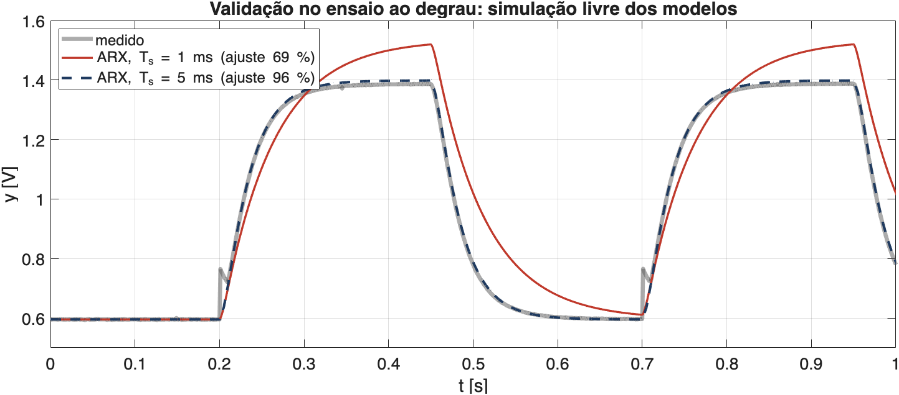
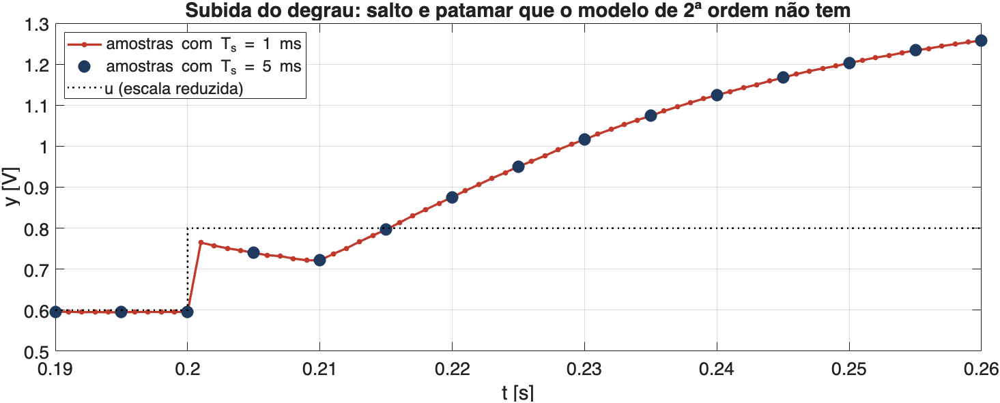
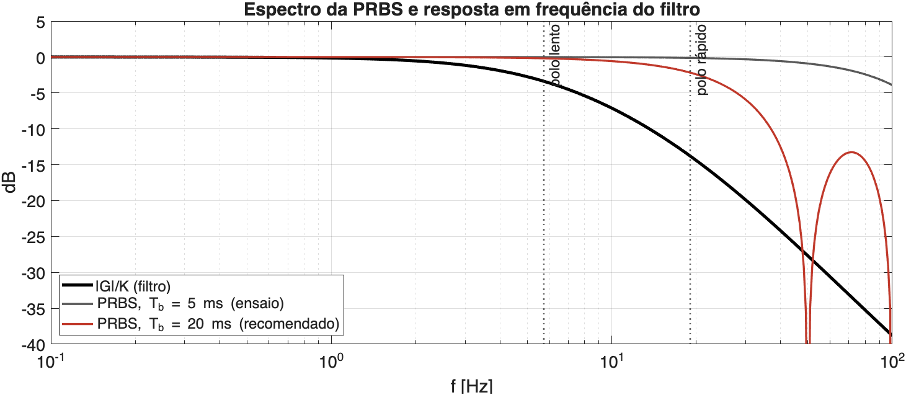
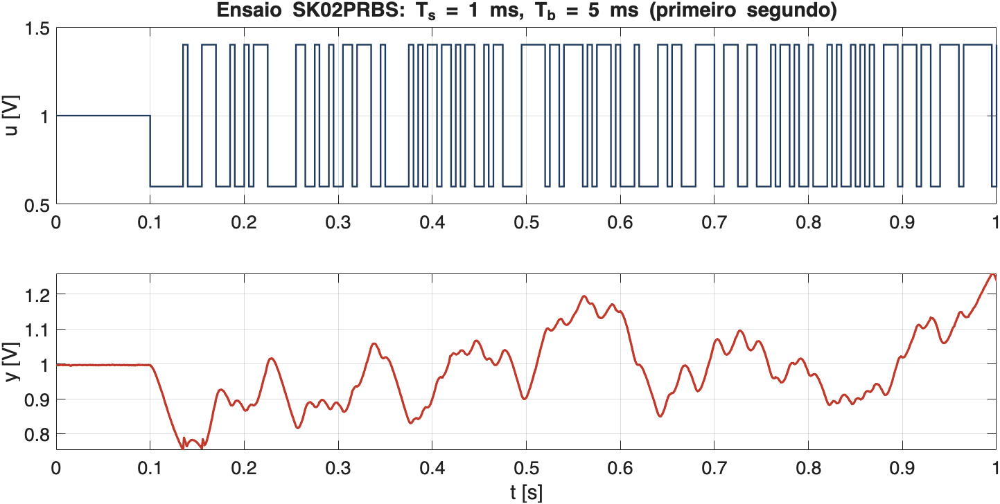
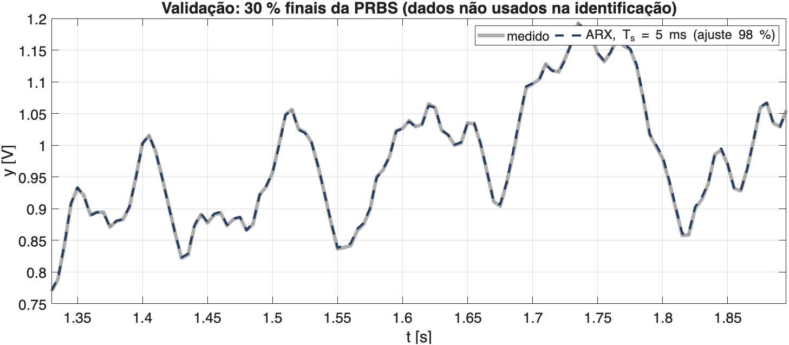

## O filtro e os ensaios

:::: {.columns}
::: {.column width="50%"}
Filtro passa-baixas de 2ª ordem (Sallen-Key, ganho unitário) ligado à LaunchPad:

- $u$: DAC-A (DACOUTA, J3.30) → entrada do filtro;
- $y$: saída do filtro → ADC-A (ADCINA3, J3.26);
- Ensaios `SK01Degrau` (onda quadrada 0,6 ↔ 1,4 V) e `SK02PRBS` (PRBS 1,0 ± 0,4 V),
  gravados com $T_s$ = 1 ms e $T_b$ = 5 ms.

Placa e exportação dos dados: [Placa LAUNCHXL-F28379D](../Nota01LaunchPadF28379D.qmd).
:::
::: {.column width="50%"}
| Grandeza (modelo identificado) | Valor |
|---|---|
| Ganho estático $K$ | 1,00 |
| Polo lento | 36 rad/s (5,7 Hz; $\tau_1$ = 28 ms) |
| Polo rápido | 120 rad/s (19 Hz; $\tau_2$ = 8,4 ms) |
| Tempo de subida | 66 ms |
| Acomodação (2 %) | 118 ms |
| Ruído de medida | 0,5 mV |
:::
::::

## O problema: ARX com $T_s$ = 1 ms

{fig-align="center" width="95%"}

O ARX(2,2,1) identificado com as amostras de 1 ms sai com ganho 1,18 e polo lento de 60 ms
(o dobro do real). **Com os mesmos dados, tomados a cada 5 ms**, o ajuste vai de 69 % a 96 %.

## Por que $T_s$ = 1 ms atrapalha

O ARX escolhe os coeficientes que melhor **preveem $y(k)$ a partir de $y(k-1)$, $y(k-2)$, $u(k-1)$, $u(k-2)$**:

- Com $T_s$ = 1 ms, o polo lento anda só $\omega_1 T_s$ = 0,036 por amostra: $y(k) \approx y(k-1)$,
  e a previsão de um passo acerta quase de graça;
- O que sobra para os coeficientes "explicarem" são os detalhes rápidos de uma amostra para
  a outra: o ruído e o que o modelo de 2ª ordem não tem;
- Resultado: previsão de um passo boa, simulação livre ruim (ganho e polo lento errados).

| [$T_s$]{style="text-transform:none"} | [1 ms]{style="text-transform:none"} | [2 ms]{style="text-transform:none"} | [5 ms]{style="text-transform:none"} | [10 ms]{style="text-transform:none"} |
|---|---|---|---|---|
| $\omega_1 T_s$ (polo lento) | 0,036 | 0,072 | **0,18** | 0,36 |
| $\omega_2 T_s$ (polo rápido) | 0,12 | 0,24 | **0,60** | 1,20 |

## O que o modelo não tem: a subida

{fig-align="center" width="95%"}

Em toda subida de $u$, $y$ salta 0,17 V e fica num patamar por ≈ 10 ms antes de subir; na
descida, não. Por ser só na subida, não é linear (provavelmente o amplificador operacional).
Com 1 ms, esse trecho pesa na previsão de um passo; a cada 5 ms, quase some.

## Escolha: $T_s$ = 5 ms

- **Regra para 2ª ordem** (Åström & Wittenmark): $\omega T_s \approx 0{,}2$ a $0{,}6$; com
  5 ms, o polo lento fica em 0,18 e o rápido em 0,60: os dois na faixa;
- Com 10 ms, o polo rápido passa de 1 (quase uma amostra por constante de tempo).

Varredura simulada (planta = modelo identificado, ruído de 0,5 mV, 50 ensaios), ajuste do ARX no degrau:

| [$T_s$ × $T_b$]{style="text-transform:none"} | [5 ms]{style="text-transform:none"} | [10 ms]{style="text-transform:none"} | [20 ms]{style="text-transform:none"} | [40 ms]{style="text-transform:none"} |
|---|---|---|---|---|
| 1 ms | 90,7 % | 92,3 % | 92,7 % | 92,9 % |
| 2 ms | — | 99,0 % | 98,8 % | 98,8 % |
| **5 ms** | 99,9 % | 99,9 % | **99,9 %** | 99,9 % |

Mesmo sem o patamar da subida, 1 ms já perde 7 a 9 pontos: o $T_s$ é o que mais pesa.

## PRBS: $T_b$ e $N_b$

Registrador de 8 bits ($x^8 + x^6 + x^5 + x^4 + 1$): 255 bits; bit de duração $T_b = N_b T_s$.

1. **Excitar o polo rápido**: faixa $0{,}44/T_b \gtrsim f_2$ = 19 Hz $\Rightarrow T_b \lesssim$ 23 ms;
2. **Excitar o ganho estático**: pulso mais longo $8\,T_b \gtrsim$ acomodação (118 ms)
   $\Rightarrow T_b \gtrsim$ 15 ms.

| Grandeza | Ensaio feito | Recomendado |
|---|---|---|
| $T_s$, $N_b$ | 1 ms, 5 | **5 ms, 4** |
| $T_b = N_b T_s$ | 5 ms | **20 ms** |
| Faixa excitada $0{,}44/T_b$ | 88 Hz | 22 Hz |
| Pulso mais longo $8\,T_b$ | 40 ms | 160 ms |
| 2000 amostras | 2 s (1,6 período) | 10 s (2 períodos) |

## Espectro da PRBS × filtro

{fig-align="center" width="95%"}

Com $T_b$ = 5 ms, a energia vai até 90 Hz, onde o filtro já atenua mais de 30 dB.
Com $T_b$ = 20 ms, ela fica até ≈ 22 Hz, cobrindo os dois polos.

## Ensaio PRBS

{fig-align="center" width="95%"}

Bits de 5 ms são curtos para o filtro: $y$ quase nunca chega aos níveis 0,6 e 1,4 V.
Para a identificação, os dados foram tomados a cada 5 ms (os bits de 5 ms continuam exatos).

## ARX por mínimos quadrados

Nas variações em torno do ponto de operação ($u_0$ = 1,0 V), com atraso de uma amostra
(o firmware lê $y(k)$ antes de escrever $u(k)$ no DAC):

$$
y(k) = a_1\,y(k-1) + a_2\,y(k-2) + b_1\,u(k-1) + b_2\,u(k-2)
$$

```matlab
du = u(101:5:end) - 1.0;   dy = y(101:5:end) - y0;    % Ts = 5 ms a partir da PRBS

function [G, th] = ARX221(du, dy, Ts)
    k   = (3:numel(dy))';
    Phi = [dy(k-1), dy(k-2), du(k-1), du(k-2)];
    th  = (Phi \ dy(k))';                               % minimos quadrados
    G   = tf([0 th(3) th(4)], [1 -th(1) -th(2)], Ts, 'Variable', 'z^-1');
end
```

Identificação com os primeiros 70 % das amostras; validação com os 30 % finais e com o degrau.

## Modelo identificado

| | [$a_1$]{style="text-transform:none"} | [$a_2$]{style="text-transform:none"} | [$b_1$]{style="text-transform:none"} | [$b_2$]{style="text-transform:none"} | [$K$]{style="text-transform:none"} | [$\tau_1$, $\tau_2$]{style="text-transform:none"} |
|---|---|---|---|---|---|---|
| ARX, $T_s$ = 1 ms | 1,726 | −0,730 | 0,0048 | 0,0002 | 1,18 | 60 ms, 3,4 ms |
| **ARX, $T_s$ = 5 ms** | **1,373** | **−0,447** | **0,0505** | **0,0241** | **1,00** | **29 ms, 7,9 ms** |
| OE, $T_s$ = 5 ms | 1,386 | −0,460 | 0,0507 | 0,0231 | 1,00 | 28 ms, 8,4 ms |

Com $T_s$ = 5 ms, ARX e OE praticamente coincidem: ajuste de 96 % no degrau e 98 % na PRBS.

## Validação: 30 % finais da PRBS

{fig-align="center" width="95%"}

Simulação livre do ARX ($T_s$ = 5 ms) com a entrada medida, a partir de dados que não
entraram na identificação: ajuste de 98 %.

## ARX × OE

Os dois dão **a mesma forma de modelo**, $G(z) = \dfrac{b_1 z^{-1} + b_2 z^{-2}}{1 - a_1 z^{-1} - a_2 z^{-2}}$;
muda só o critério do ajuste:

| | ARX | OE (erro de saída) |
|---|---|---|
| O que minimiza | erro da **previsão de um passo**, com o $y$ medido | erro da **simulação livre**, com o $y$ do próprio modelo |
| Cálculo | mínimos quadrados (uma conta) | otimização iterativa (`oe` do MATLAB) |
| Sensível a $T_s$ pequeno e ruído | sim | pouco |

- Para controle, os dois servem igualmente: P, PI, MPC usam $G(z)$, que tem a mesma forma;
- Com $T_s$ bem escolhido, o ARX já acerta; o OE fica como conferência.

## Próximo ensaio: `SK02PRBS`

```c
const ParametrosPRBS p = {
    .Ts       = 5e-3f,    // 5 ms: polos com wTs = 0,18 e 0,6
    .u0       = 1.0f,     // ponto de operacao [V]
    .A        = 0.4f,     // u em 0,6 ou 1,4 V
    .Tb       = 20e-3f,   // Nb = 4: faixa 22 Hz, pulso maior 160 ms
    .tPre     = 0.1f,
    .tAcomoda = 2.0f,
    .semente  = 0x01U,
};
```

- Projeto já com esses valores; 2000 amostras = 10 s, quase 2 períodos da PRBS;
- `SK01Degrau` pode ficar em 1 ms: para validar, toma-se uma amostra a cada 5.

## Modelos usados nas notas de controle

| Nota | Modelo | Origem |
|---|---|---|
| [Planejamento](../ControleSallenKey/index.qmd), [Controle P](../ControleProporcional/index.qmd), [Controle PI](../ControlePI/index.qmd) | ARX(1,3,1), $T_s$ = 5 ms | ensaio PRBS anterior (`DadosPRBS01.csv`) |
| [Controle Preditivo](../ControlePreditivo/index.qmd) | ARX(2,2,1), $T_s$ = 1 ms | ensaio PRBS anterior (`DadosPRBS1ms.csv`) |

- Nesse ensaio anterior, o ARX a 1 ms saiu bom ($K$ = 1,00; $\tau_1$ = 26 ms); com os dados
  atuais, não: em 1 ms o resultado depende do ensaio;
- Para controlar em 1 ms, identificar em 5 ms e converter: `c2d(d2c(G, 'zoh'), 1e-3)`.

## Conclusões

- **$T_s$ = 5 ms** para identificar: os dois polos com $\omega T_s$ entre 0,18 e 0,6;
  com 1 ms, o ARX erra o ganho e o polo lento;
- **$T_b$ = 20 ms ($N_b$ = 4)**: faixa até 22 Hz (cobre o polo de 19 Hz) e pulso mais longo
  de 160 ms (mais que a acomodação);
- **ARX(2,2,1)** com $T_s$ = 5 ms: $K$ = 1,00, $\tau$ = 29 e 7,9 ms, ajuste de 96 a 98 %;
  igual ao OE;
- A subida tem um salto e um patamar que o modelo linear não representa: vale investigar
  o amplificador operacional.

Código: `analise/ident_sk.m` (figuras e números desta apresentação).
