## O que vamos fazer

- Montar o inversor **BOOSTXL-3PHGANINV** sobre a **LaunchPad F28379D**;
- Gravar um programa que liga e desliga as chaves do inversor (PWM), **sem controle**: as
  medidas não voltam para o cálculo, por isso o nome *malha aberta*;
- Ver os sinais no osciloscópio, em duas etapas:

| Etapa | Montagem | O que se mede |
|---|---|---|
| A | só a LaunchPad, ligada na USB | os sinais de comando (0 a 3,3 V) |
| B | LaunchPad + inversor + fonte de 12 V + carga RL | as tensões das fases e as correntes |

**Material**: as duas placas, cabo USB, osciloscópio de dois canais (100 MHz ou mais),
fonte CC com limite de corrente, carga RL trifásica (4,7 Ω e 1 mH por fase) e fita Kapton.

## O inversor trifásico

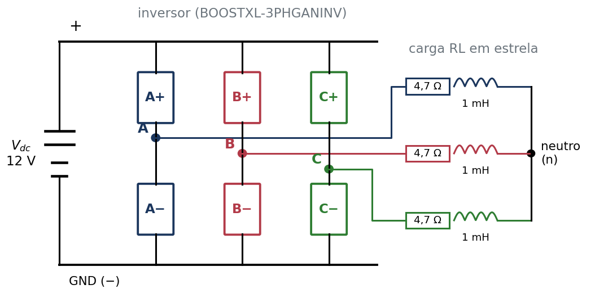{width="80%" fig-align="center"}

- Transforma a tensão contínua da fonte ($V_{dc}$) em três tensões alternadas, uma em cada fase;
- Faz isso ligando e desligando seis chaves muito rápido (20 mil vezes por segundo);
- Cada coluna de duas chaves (A+ e A−, por exemplo) é um **braço**.

## Um braço do inversor

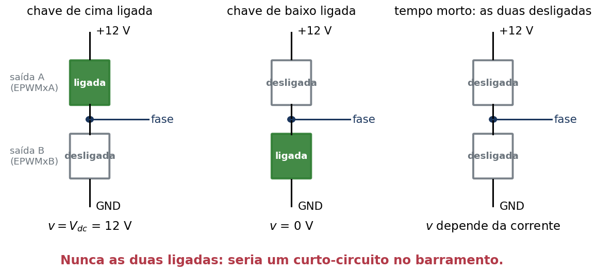{width="85%" fig-align="center"}

- A placa de controle manda dois sinais para cada braço: **saída A** (chave de cima) e
  **saída B** (chave de baixo);
- Entre desligar uma chave e ligar a outra, espera-se um pouco: o **tempo morto**.

## Razão cíclica e tensão média

Num período de PWM (50 µs), a chave de cima fica ligada uma fração $d$ do tempo, a
**razão cíclica**. A fase fica em 12 V durante essa fração e em 0 V no resto. Em média:

$$
v_{\text{média}} = d \cdot V_{dc}
$$

| Razão cíclica [$d$]{style="text-transform:none"} | Chave de cima ligada | Tensão média da fase (12 V) |
|---|---|---|
| 25 % | 12,5 µs de cada 50 µs | 3 V |
| 50 % | 25 µs | 6 V |
| 75 % | 37,5 µs | 9 V |

Mudando $d$ devagar, como uma senoide, a tensão média vira uma senoide: é assim que o
inversor gera corrente alternada.

## Como a placa gera o PWM

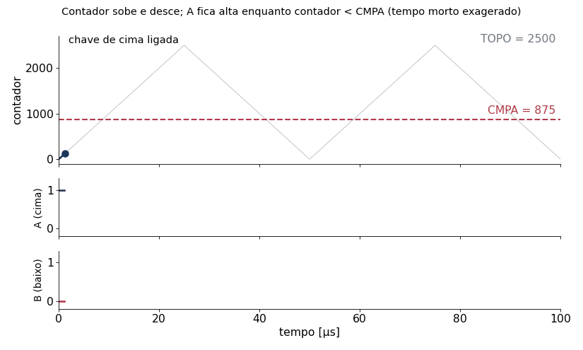{width="80%" fig-align="center"}

Um **contador** sobe de 0 a 2500 e desce de volta, sem parar. A saída A fica em nível alto
enquanto o contador está **abaixo** do valor de comparação (CMPA); a saída B é o contrário.

## Os números do PWM

| Grandeza | Valor | De onde vem |
|---|---|---|
| Relógio do PWM | 100 MHz | 200 MHz do processador ÷ 2: cada contagem dura 10 ns |
| Topo do contador | 2500 | 100 MHz ÷ (2 × 20 kHz) |
| Período do PWM | 50 µs | 2 × 2500 contagens × 10 ns |
| Razão cíclica | CMPA ÷ 2500 | CMPA = 1250 → 50 % |
| Tempo morto | 100 ns | 10 contagens |

No programa: `FREQ_PWM`, `TOPO`, `TEMPO_MORTO` e `CONTAGENS_MORTO`, no começo do `main.c`.

## Tempo morto

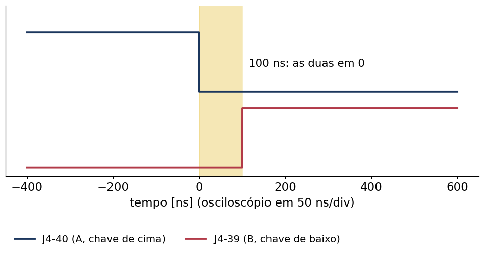{width="78%" fig-align="center"}

- Uma chave não desliga instantaneamente: se a outra ligasse no mesmo instante, as duas
  conduziriam juntas e haveria um curto no barramento;
- Durante 100 ns, **as duas saídas ficam em 0**. Não existe instante com as duas em 1;
- O módulo de PWM cria esse atraso sozinho (submódulo *dead-band*).

## Os três modos de teste

| Modo | Razão cíclica | Para que serve |
|---|---|---|
| 0 | 50 % nas três fases | primeiro teste: as três fases iguais, nenhuma tensão na carga |
| 1 | 25 % em A, 50 % em B, 75 % em C | reconhecer qual fio é qual fase |
| 2 | senoide de 60 Hz, 120° entre as fases | ver o inversor gerando corrente alternada |
| 3 | manual: `razaoManual` (A, B, C) | escolher a razão cíclica de cada fase |

No modo 2, para cada fase,

$$
d = 0{,}5 + 0{,}5 \cdot \text{indice} \cdot \sin(\theta - \text{defasagem}), \quad
\text{defasagem} = 0^\circ,\ 120^\circ,\ 240^\circ
$$

com o **índice de modulação** entre 0 e 1 (0,5 no início).

## Modos 0 e 1 no osciloscópio

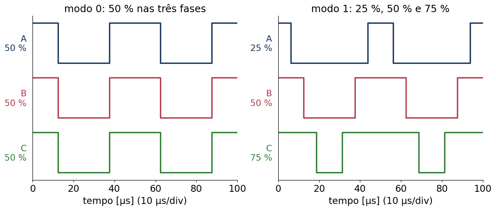{width="90%" fig-align="center"}

- Modo 0: as três fases idênticas;
- Modo 1: a largura do pulso identifica a fase (estreito = A, médio = B, largo = C);
- Os pulsos ficam centrados nos instantes em que o contador vale zero.

## Modo 2: as razões cíclicas giram

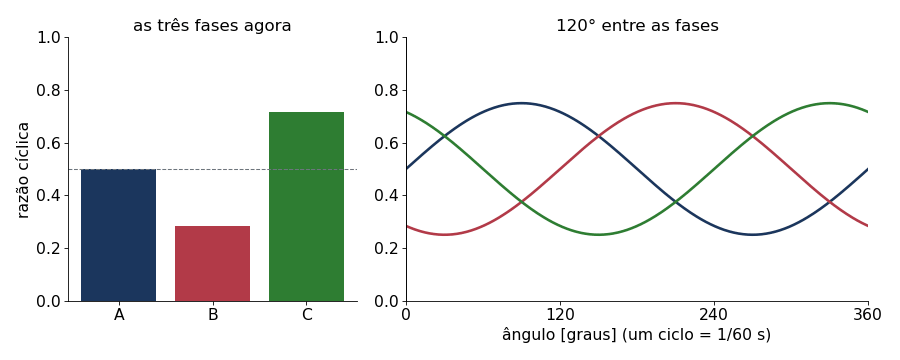{width="88%" fig-align="center"}

As três razões cíclicas oscilam em torno de 50 %, deslocadas de um terço de ciclo
(120°). Um ciclo completo dura 1/60 s ≈ 16,7 ms.

## Modo 2 no osciloscópio

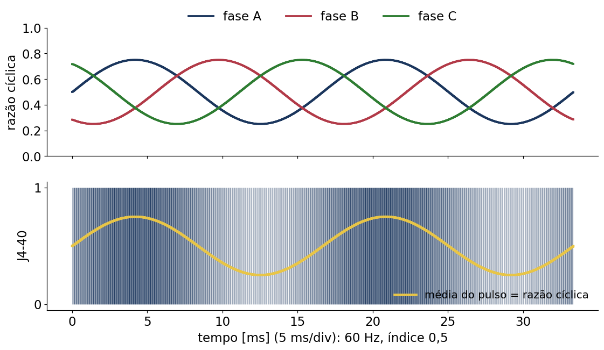{width="82%" fig-align="center"}

Em 5 ms/div os pulsos de 50 µs ficam muito juntos; o que se vê é uma faixa mais escura
(pulsos largos) e mais clara (pulsos estreitos), repetindo a cada 16,7 ms.

## O programa: um arquivo só

```
main()                       roda uma vez
├─ ConfiguraPinos()          habilitação desligada; GPIO0..5 viram saídas de PWM
├─ ConfiguraModuloPWM() ×3   contador, comparação, tempo morto, proteção na pausa
├─ ConfiguraADC()            conversões disparadas pelo PWM da fase A
├─ liga a interrupção        AtualizaPWM a cada 50 µs
└─ laço infinito             copia "habilita" para o pino de habilitação
```

```
AtualizaPWM()                a cada 50 µs (contador = 0)
├─ calcula razaoCiclica[3]   de acordo com o modo
├─ EscreveRazao()            razão → CMPA (limitada entre 5 % e 95 %)
└─ LeTensoes()               lê as tensões e grava, se pedido
```

`ProjetosVSI/VSI01MalhaAberta/main.c`: cerca de 300 linhas, com comentários em cada passo.

## Variáveis que você pode mudar

| Variável | Valores | Efeito |
|---|---|---|
| `modo` | 0 a 3 | escolhe o teste |
| `habilita` | 0 ou 1 | 1 liga o inversor (só na etapa B) |
| `indice` | 0 a 1 | amplitude da senoide do modo 2 |
| `frequencia` | em Hz | frequência da senoide do modo 2 |
| `razaoManual` | 0,05 a 0,95 (três valores) | razões das fases A, B, C no modo 3 |
| `grava` | 1 | grava as tensões das fases |

No CCS, essas variáveis vão para a janela **Watch**. Para mudar um valor: pausar o programa
(*Suspend*), digitar o valor novo e continuar (*Resume*).

## Variáveis para observar

| Variável | O que mostra |
|---|---|
| `razaoCiclica` | razões cíclicas aplicadas nas fases A, B, C |
| `tensaoBarramento` | tensão da fonte [V], medida pelo inversor |
| `grava` | 2 enquanto grava, 0 quando terminou |
| `amostra` | quantas amostras já foram gravadas (até 2000) |
| `tensaoA`, `tensaoB`, `tensaoC` | os vetores gravados [V], para exportar em CSV |

## O que o programa faz pela segurança

- **Habilitação ativa em nível baixo**: o inversor só liga com o pino GPIO124 em 0. O
  programa começa com 1 e só escreve 0 quando `habilita` = 1;
- **Pausa do depurador**: quando o programa está pausado, as saídas A e B vão para 0 (as
  duas chaves desligam). Sem isso, o PWM congelaria com uma chave ligada direto;
- **Limites da razão cíclica** (5 % a 95 %): nenhum pulso fica mais curto que o tempo morto;
- Os três contadores partem juntos (o relógio comum é liberado depois de configurar os três).

## Montagem: onde ficam J1–J4 na LaunchPad

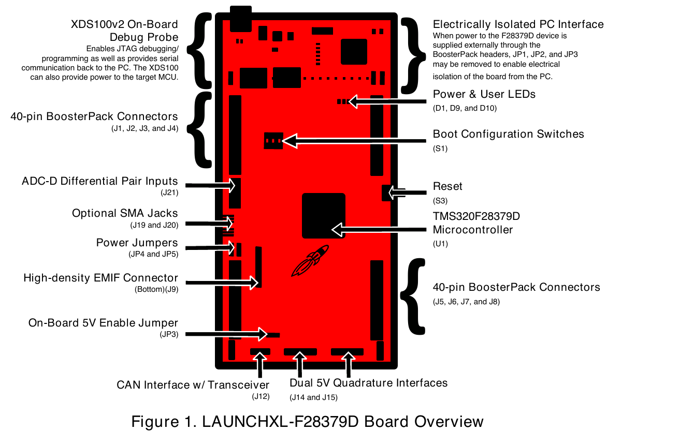{width="62%" fig-align="center"}

[LAUNCHXL-F28379D (SPRUI77C, fig. 1). O inversor usa os conectores J1, J2, J3 e J4, na
metade de cima, perto da USB, e não J5–J8.]{style="font-size:0.6em"}

## Montagem: o inversor na posição de encaixe

:::: {.columns}
::: {.column width="52%"}
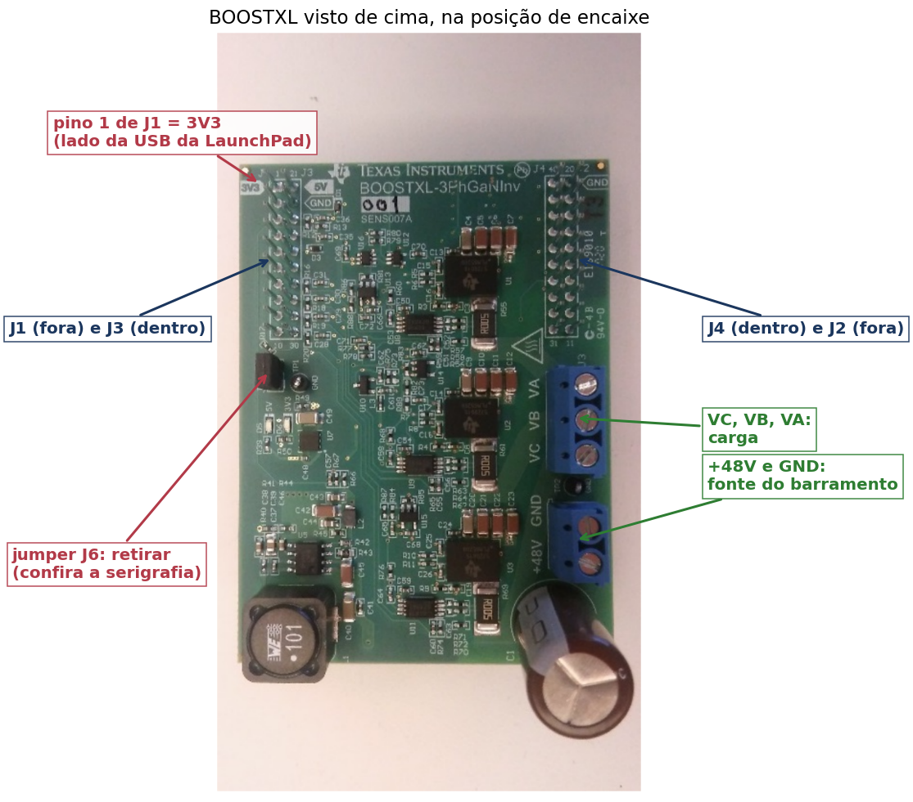{width="100%"}
:::
::: {.column width="48%"}
- A foto da TI (SLUUBP1A, fig. 4) foi girada para a posição em que a placa fica sobre a
  LaunchPad;
- Os conectores do inversor estão na **face de baixo**; na face de cima aparecem só os
  pinos soldados;
- O canto marcado **3V3** fica do lado da USB da LaunchPad;
- Fonte nos bornes **+48V/GND** (usaremos 12 V); carga nos bornes **VA, VB, VC**.
:::
::::

## Montagem: alinhamento

:::: {.columns}
::: {.column width="45%"}
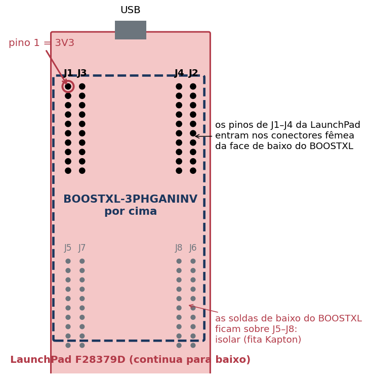{width="82%"}

[Esquema fora de escala.]{style="font-size:0.6em"}
:::
::: {.column width="55%"}
- **3V3 sobre 3V3**: o pino 1 de J1 do inversor encaixa no pino 1 de J1 da LaunchPad,
  marcado 3V3 nas duas placas;
- Conferir também **5V sobre 5V** e **GND sobre GND** pela serigrafia;
- Encaixado ao contrário, as alimentações ficam trocadas e as placas podem queimar;
- O inversor passa por cima de J5–J8: as soldas de baixo não podem encostar neles.
:::
::::

## Antes de encaixar

1. **Tudo desligado**: sem USB e sem fonte;
2. Retirar o **jumper J6** do inversor: ele levaria 3,3 V do inversor para a LaunchPad, que
   já é alimentada pela USB;
3. Fita Kapton (ou espaçadores) entre as placas, sobre J5–J8 e os jumpers da LaunchPad;
4. Ver a revisão impressa na LaunchPad: na **revisão 1.1**, o pino J3-29 está em curto com a
   referência do ADC, e esse pino recebe a medida de corrente da fase C. Nesse caso, falar com
   o professor antes de encaixar;
5. Encaixar com 3V3 sobre 3V3, sem forçar e sem entortar os pinos.

## No Code Composer Studio (Mac)

1. *File → Open Folder*: a pasta `ProjetosVSI` (ou a pasta descompactada do `.zip`);
2. Selecionar o projeto `VSI01MalhaAberta` e compilar (ícone do martelo, *Build*);
3. Ligar a LaunchPad na USB e iniciar a depuração (ícone do inseto, *Debug*): o programa é
   gravado e fica parado no início do `main`;
4. Na janela **Watch**, acrescentar `modo`, `habilita`, `indice`, `frequencia` e
   `razaoCiclica`;
5. *Resume* (▶): o PWM começa.

## Etapa A: onde ligar o osciloscópio

Só a LaunchPad, alimentada pela USB. As pontas vão direto nos pinos de J4:

| Pino | Sinal | Fase |
|---|---|---|
| J4-40 | EPWM1A | A, chave de cima |
| J4-39 | EPWM1B | A, chave de baixo |
| J4-38 / J4-37 | EPWM2A / 2B | B |
| J4-36 / J4-35 | EPWM3A / 3B | C |
| J2-20 ou J3-22 | GND | terra das duas pontas |

Escala vertical de 1 V/div: os sinais vão de 0 a 3,3 V.

## Etapa A: os pinos na placa

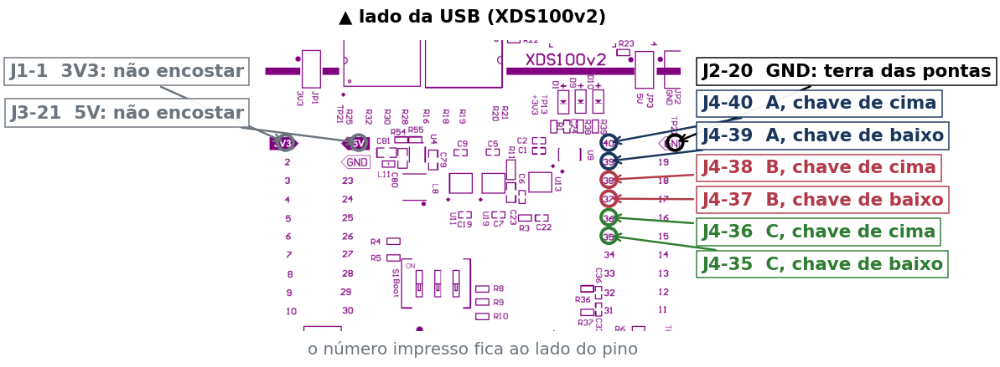{width="95%" fig-align="center"}

LaunchPad vista de cima, com a USB para cima: J4 é a coluna de dentro, à direita, com o pino
40 no alto; J2 é a de fora, com o GND (pino 20) ao lado do 40.

## Etapa A: roteiro

1. `modo` = 0, J4-40 e J4-39 em 10 µs/div: 20 kHz, 50 %, um sinal o inverso do outro;
2. Zoom numa borda (50 ns/div): os dois em 0 durante ≈ 100 ns, nunca os dois em 1;
3. `modo` = 1: J4-40, J4-38 e J4-36 com 25 %, 50 % e 75 % (troque a ponta de pino);
4. `modo` = 2, 5 ms/div: a largura do pulso varia como senoide; mudar `indice` (0,2 e 0,9) e
   `frequencia` (30 Hz e 60 Hz) e ver a diferença;
5. Pausar o programa: todas as saídas vão para 0.

## Ver a senoide: um filtro RC

O osciloscópio mostra pulsos; a senoide está na **média** deles. Um filtro passa-baixas de
primeira ordem faz essa média:

| Componente | Valor | Por quê |
|---|---|---|
| Resistor | 10 kΩ, 1/4 W | limita a corrente: 0,33 mA na LaunchPad, 1,2 mA no inversor |
| Capacitor | 100 nF, 50 V (cerâmico ou poliéster) | com 10 kΩ, frequência de corte de 159 Hz |

| Frequência | O que acontece no filtro |
|---|---|
| 60 Hz (a senoide) | passa 94 %, com atraso de 21° (≈ 1 ms) |
| 20 kHz (o PWM) | cai 126 vezes: sobra uma ondulação pequena |

## Ligação do filtro

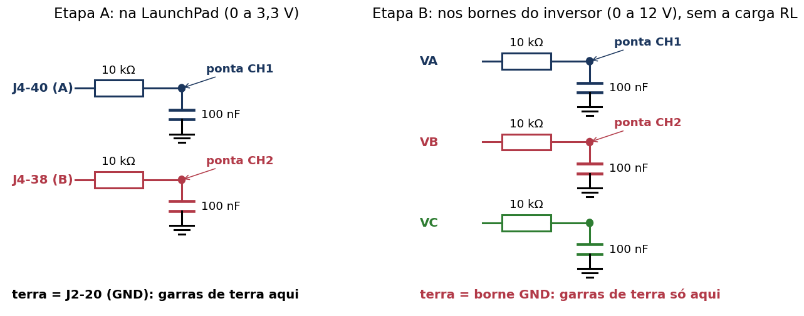{width="92%" fig-align="center"}

- Um RC por canal; a ponta vai no **ponto entre o resistor e o capacitor**;
- O resistor fica **sempre** entre o pino e o capacitor: ele protege o pino (sem ele, o
  capacitor descarregado seria um curto a cada pulso);
- Monte numa protoboard e ligue à placa com jumpers fêmea-macho.

## Etapa A com o filtro RC

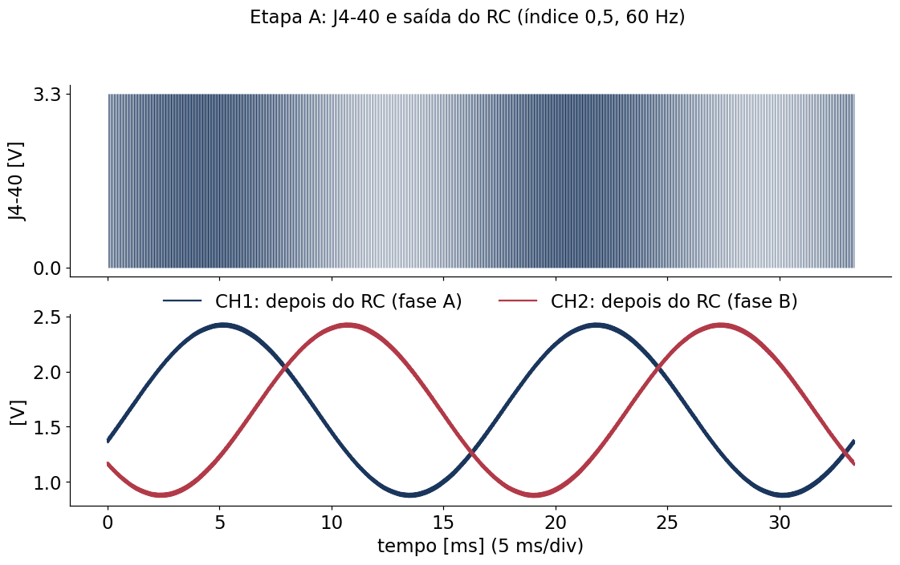{width="72%" fig-align="center"}

`modo` = 2, `indice` = 0,5, 60 Hz, 0,5 V/div e 5 ms/div: senoide de **1,65 ± 0,78 V** (de
0,87 a 2,43 V), com 120° (5,6 ms) entre A e B. Mude `indice` e `frequencia` e veja a senoide
acompanhar. No modo 1, o filtro mostra só tensões constantes: 0,83, 1,65 e 2,48 V.

## Etapa B: ordem de ligação

1. Placas encaixadas, **sem carga** nos bornes VA, VB, VC;
2. LaunchPad na USB, programa rodando com `habilita` = 0 e `modo` = 0;
3. Fonte ajustada em **12 V** com limite de **0,5 A**, ainda desligada; ligar nos bornes
   +48V (positivo) e GND (negativo);
4. Ligar a fonte: a corrente deve ficar perto de zero; acendem os LEDs 5V e 3V3 do inversor;
5. `habilita` = 1.

Para desligar, a ordem inversa: `habilita` = 0, fonte, USB.

## Cuidado com o terra do osciloscópio

- A garra de terra das pontas comuns é ligada ao terra da tomada;
- Ela só pode ir no **GND do inversor** (borne GND, negativo da fonte);
- **Nunca** prender a garra de terra em VA, VB ou VC: isso põe uma fase em curto com o terra;
- A tensão **entre duas fases** se mede com duas pontas (VA e VB contra o GND) e a função
  matemática A − B do osciloscópio.

## Etapa B sem carga

Ponta em VA, terra no GND, 10 µs/div e 5 V/div:

| Modo | VA | VB | VC |
|---|---|---|---|
| 0 | 0 ↔ 12 V, 50 % | igual a VA | igual a VA |
| 1 | 0 ↔ 12 V, 25 % | 50 % | 75 % |
| 2 | largura variando a 60 Hz | 120° depois | 240° depois |

Com `habilita` = 0, as chaves ficam desligadas e o borne fica solto: o osciloscópio não mostra
os pulsos.

## Etapa B com o filtro RC

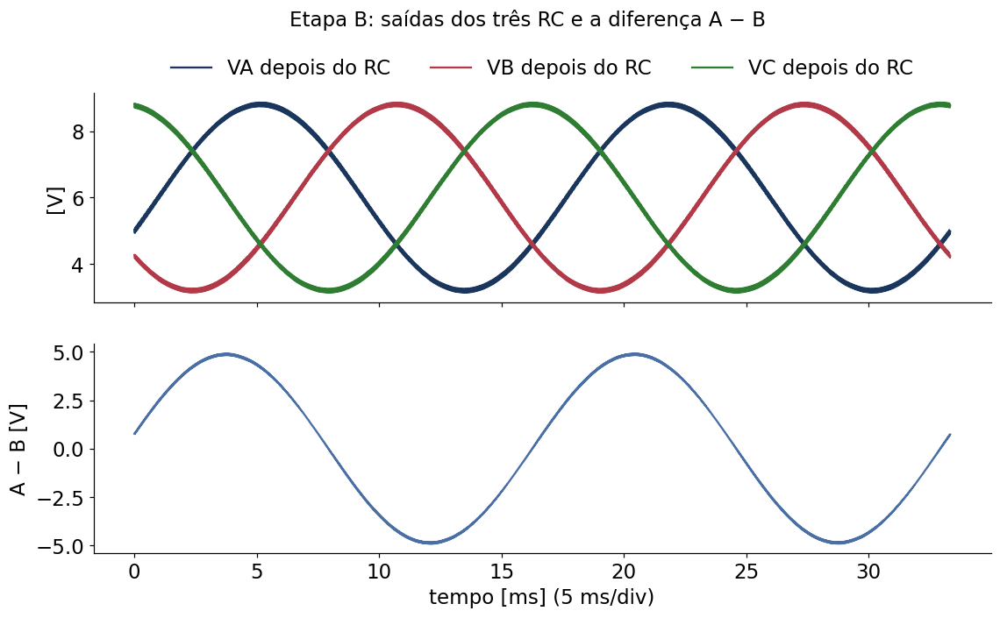{width="66%" fig-align="center"}

Um RC em cada borne (VA, VB, VC), no lugar da carga RL; capacitores de **50 V**. Com 12 V,
`modo` = 2 e `indice` = 0,5: cada fase com **6 ± 2,8 V**; a diferença A − B (função matemática do
osciloscópio) com **4,9 V de pico**, √3 vezes a amplitude de uma fase. A fonte quase não
fornece corrente (alguns miliampères): um bom primeiro teste com carga, antes da RL.

## Gravar as tensões das fases

O inversor mede a tensão de cada borne (dividida por 24,7 e filtrada em 1 kHz) e o programa
lê esses sinais a cada 50 µs:

1. Com o inversor ligado e o modo escolhido, escrever **`grava` = 1** na Watch e dar *Resume*;
2. Esperar `grava` voltar a 0 (2000 amostras = 100 ms, seis ciclos de 60 Hz);
3. Pausar, acrescentar `tensaoA`, `tensaoB` e `tensaoC` na Watch e **exportar para CSV**
   (botão direito na janela Watch, *Export*);
4. `python3 analise/plota_tensoes.py arquivo.csv`: monta o tempo, plota e grava um CSV com
   as colunas `t_ms, vA, vB, vC`.

O filtro da placa já faz a média dos pulsos: no modo 2 aparece a senoide (com uma ondulação
de alguns décimos de volt), sem filtro externo.

## Etapa B com carga: modos 0 e 1

Desligar a fonte, ligar a carga RL nos bornes VA, VB, VC e religar (limite em 0,5 A).

- **Modo 0**: as três fases iguais o tempo todo, então não há tensão entre elas: corrente nula,
  e a fonte quase não fornece corrente;
- **Modo 1**: tensões médias de 3, 6 e 9 V; o centro da estrela fica em 6 V, então as fases
  ficam com −3, 0 e +3 V:

$$
i_A = \frac{-3}{4{,}7} = -0{,}64\ \text{A}, \qquad i_B = 0, \qquad i_C = +0{,}64\ \text{A}
$$

São correntes **contínuas**: os resistores esquentam (1,9 W em A e em C) e a fonte fornece
≈ 0,32 A.

## Etapa B com carga: modo 2

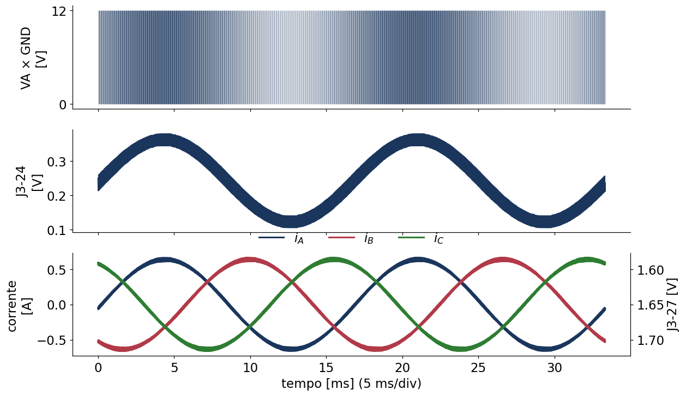{width="70%" fig-align="center"}

[Simulação (`analise/figuras.py`): 12 V, índice 0,5, 60 Hz.]{style="font-size:0.6em"}

Tensão de fase com 3 V de pico, corrente com **0,64 A de pico** e 60 Hz, quase em fase com a
tensão (a indutância de 1 mH pouco pesa a 60 Hz).

## Medir a corrente sem ponta de corrente

O próprio inversor mede a corrente e a tensão de cada fase e entrega os sinais nos pinos de J3
(acessíveis pela face de cima do inversor):

| Pino | Sinal | Conversão |
|---|---|---|
| J3-27 | corrente da fase A | [$v = 1{,}65 - 0{,}1\, i_A$]{style="text-transform:none"} (V, A) |
| J3-24 | tensão de VA, filtrada | [$v = V_A / 24{,}7$]{style="text-transform:none"} (filtro de 1 kHz) |

- O sinal de J3-27 é **invertido**: corrente positiva faz a tensão cair;
- Modo 2 com índice 0,5: J3-27 oscila entre 1,59 e 1,71 V; J3-24 entre 0,12 e 0,36 V (a
  média dos pulsos aparece como senoide).

## Valores esperados (12 V)

| Ensaio | Corrente de pico | J3-27 | Corrente da fonte |
|---|---|---|---|
| Modo 0 | 0 | 1,65 V | ≈ 0 |
| Modo 1 | −0,64 A (contínua) | 1,71 V | 0,32 A |
| Modo 2, índice 0,5 | 0,64 A | 1,59 a 1,71 V | 0,24 A |
| Modo 2, índice 0,8 | 1,02 A | 1,55 a 1,75 V | 0,61 A |

Para o índice 0,8, subir o limite da fonte para 1 A. Se a fonte entrar em limitação de
corrente com valores bem menores, desligue e confira a montagem.

## Se algo não funcionar

| Sintoma | Verificar |
|---|---|
| Nenhum pulso em J4 | o programa está rodando (*Resume*)? a ponta está no pino certo? |
| Pulsos em J4, nada em VA | `habilita` = 1? fonte ligada? (o inversor só funciona com ela) |
| LEDs 5V/3V3 apagados | fonte desligada ou invertida |
| Fonte limita a corrente | carga em curto, modo errado, índice alto demais |
| Saídas vão a 0 sozinhas | o programa foi pausado (proteção) |

## Próximo passo

- Com o chaveamento conferido, o experimento seguinte mede as correntes no próprio
  microcontrolador e controla a corrente da carga: projeto `VSI02ControleCorrente`,
  apresentação [Controle de Corrente do Inversor Trifásico](../ControleCorrenteVSI/index.html);
- Documentos da TI usados aqui: guia do BOOSTXL-3PhGaNInv (SLUUBP1A), guia da LaunchPad
  (SPRUI77C) e o projeto de referência TIDA-00909 (TIDUCE7B).
